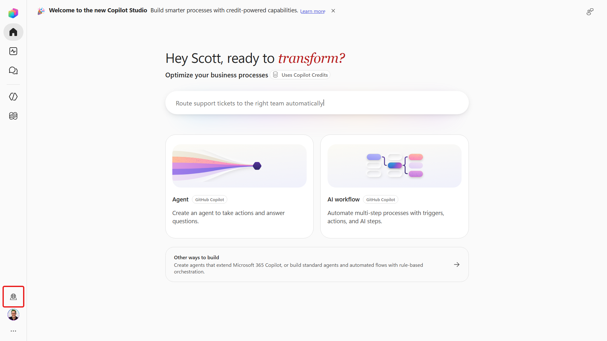

<!-- markdownlint-disable MD034 -->

# @lab.Title

**Estimated time:** 20 minutes

Welcome to **PREL36: Build your first agent in Copilot Studio**, a Microsoft Ignite 2026 pre-day lab. In four hours, you will build and test one complete IT support scenario, rather than a collection of disconnected agents.

## Scenario

Contoso employees need reliable help with common IT problems and available workplace devices. Your **Contoso IT Concierge** will use approved support sources, retrieve current inventory, and guide the user through selecting a device and providing requirements. Only after the user confirms the completed request will a workflow email it for review.

For this lab, the email goes to your own assigned lab mailbox. The workflow does not approve the request, purchase hardware, or reserve inventory.

## Sign in to the virtual machine

1. Open the **Resources** panel and identify your **Virtual Machine** credentials.
1. Sign in to the virtual machine using those credentials.
1. Find the separate **Microsoft 365** username and password or Temporary Access Pass in **Resources**.
1. Open Microsoft Edge in the virtual machine.
1. Go to +++https://copilotstudio.microsoft.com+++.
1. Sign in with the assigned **Microsoft 365** account. Use a password or Temporary Access Pass as directed by the lab resource instructions.
1. In the environment selector, choose the Power Platform environment assigned in **Resources**. Do not use an unrelated default or production environment.

    

1. If the Home page shows a **New experience** toggle, turn it **On**. Confirm the **Agent (GitHub Copilot)** creation option is available.
1. Open your assigned **Contoso IT** SharePoint site from **Resources** in another tab.
1. Open **Site contents**, then **EmployeeAssets**. Confirm that the list contains the prepared device records and columns such as **Status**, **Manufacturer**, **Model**, and **Asset Type**.
1. Confirm you can open your assigned mailbox in Outlook on the web. Keep the lab email address available for the workflow.
1. In File Explorer, look for `D:\LabFiles\PREL36`. If it is not present, use the [local downloads in this repository](./downloads/README.md).

> [!IMPORTANT]
> If the assigned environment, SharePoint list, mailbox, or GitHub Copilot harness option is missing, ask your instructor before continuing. Do not sign up for trials, purchase licenses, or change tenant-wide policies.

## Understand the building blocks

The **model** reasons and generates language. The **harness** is the operating environment around the model: it provides capabilities, manages context, and executes tool calls. **Orchestration** determines what the agent should do next.

| Building block | Role in this lab |
| --- | --- |
| Instructions | Define the agent's role, safety boundaries, and task routing |
| Knowledge | Retrieve approved guidance and cite its sources |
| Tool | Read current device records from one SharePoint list |
| Skill | Package a reusable troubleshooting or device-selection procedure |
| Workflow | Retrieve the chosen device and send a confirmed request in a defined order |
| Solution | Group related components for lifecycle management |

**Retrieval-augmented generation (RAG)** means retrieving relevant evidence before generating an answer. A knowledge answer about device policies is not a substitute for a live inventory lookup.

Copilot Studio supports different harnesses. The **Copilot chat harness** extends Microsoft 365 Copilot Chat with knowledge; the **standard harness** supports topics and structured conversation logic; the **GitHub Copilot harness** combines goal-driven reasoning with instructions, tools, skills, and workflows. This lab uses the third option. It does not require a GitHub Copilot coding subscription.

The agent can choose how to investigate an IT question. The workflow executes the defined transaction. Keep the boundary clear: **read when needed, ask before sending, and escalate rather than bypass security**.

> [!NOTE]
> Preview and published runtime usage consume Copilot Credits on this harness. Use the supplied environment and the provided tests. A Microsoft 365 Copilot user license does not replace GitHub Copilot harness credit capacity.

**Verify:** You can access the assigned Copilot Studio environment, Contoso IT site, EmployeeAssets list, and lab mailbox. You can explain why knowledge, a tool, a skill, and a workflow serve different purposes.

Select **Next** to create a solution, or open [Create a solution](./01-Create-A-Solution.md).
