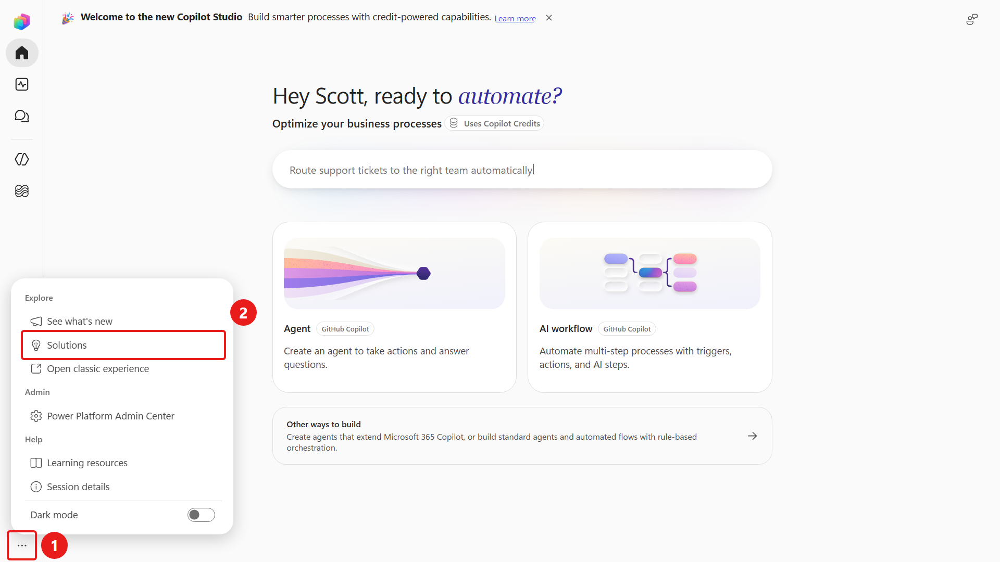
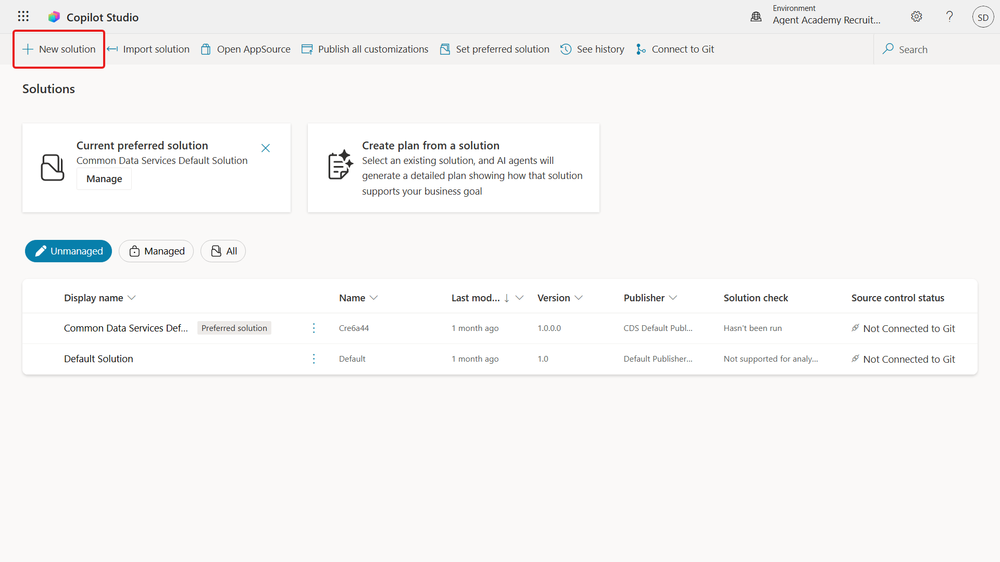
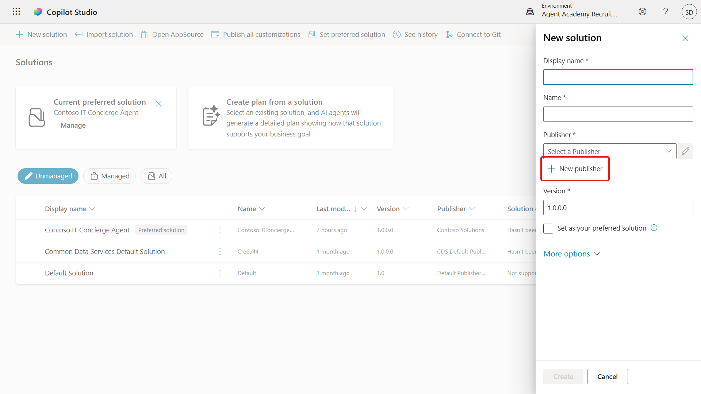
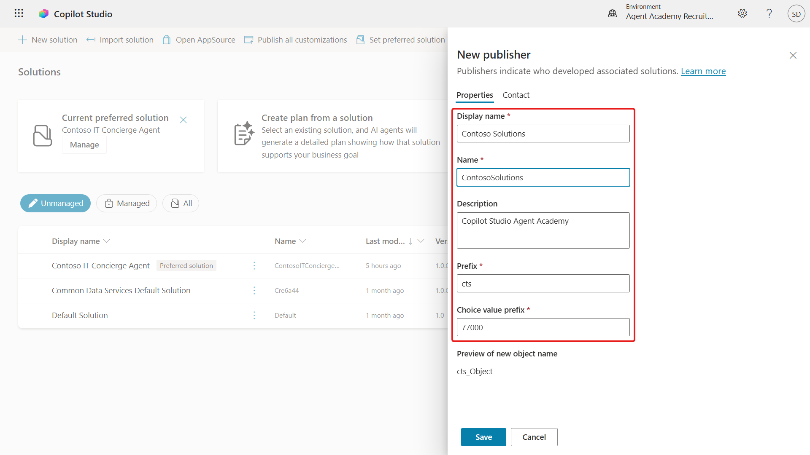
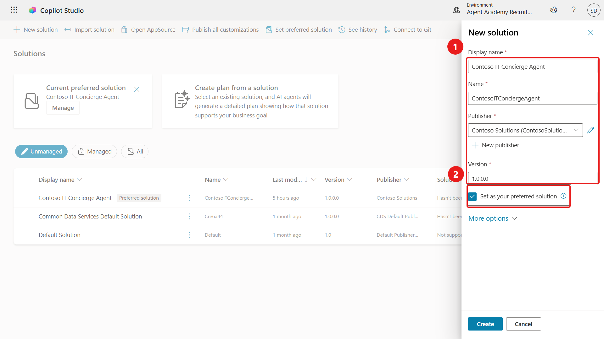
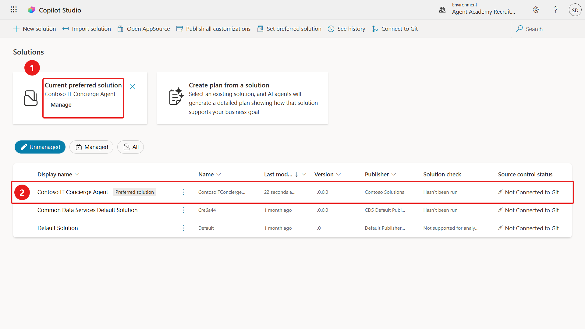

# 1 - Create a solution

**Estimated time:** 15 minutes

A Power Platform solution groups related components so they can move together between environments. You will work in an **unmanaged** solution for development. A **publisher** identifies component ownership and supplies a prefix.

## Create the publisher

1. Confirm that Copilot Studio is using your assigned lab environment.
1. From the left navigation, select the **ellipsis** near the bottom, then select **Solutions** under **Explore**.

    

1. In **Solution Explorer**, select **+ New solution**.

    

1. In the **New solution** pane, select **+ New publisher**.

    

1. On **Properties**, enter the following values:

    | Field | Value |
    | --- | --- |
    | Display name | +++Contoso Solutions+++ |
    | Name | +++ContosoSolutions+++ |
    | Description | +++Microsoft Ignite 2026 PREL36+++ |
    | Prefix | +++cts+++ |
    | Choice value prefix | Keep the automatically generated value |

    

1. Select **Save**.
1. Confirm that **Contoso Solutions** is selected in the **New solution** pane.

> [!NOTE]
> If your assigned environment already contains the publisher, reuse it rather than creating a duplicate. Do not modify a publisher owned by another lab participant.

## Create and prefer the solution

1. Enter the following values:

    | Field | Value |
    | --- | --- |
    | Display name | +++Contoso IT Concierge Agent+++ |
    | Name | +++ContosoITConciergeAgent+++ |
    | Version | `1.0.0.0` |
    | Publisher | `Contoso Solutions` |

1. Select **Set as your preferred solution**. This keeps newly created components in the intended solution.

    

1. Leave optional fields under **More options** blank.
1. Select **Create**.
1. After the empty solution opens, select the **back arrow** to return to Solution Explorer.
1. Confirm that **Contoso IT Concierge Agent** appears as the **Current preferred solution**.

    

**Verify:** Your custom solution exists and is preferred before you create the agent. If you cannot create solutions, ask your instructor to check your assigned environment role.

Select **Next** to build the agent, or open [Build and ground the agent](./02-Build-And-Ground-The-Agent.md).
