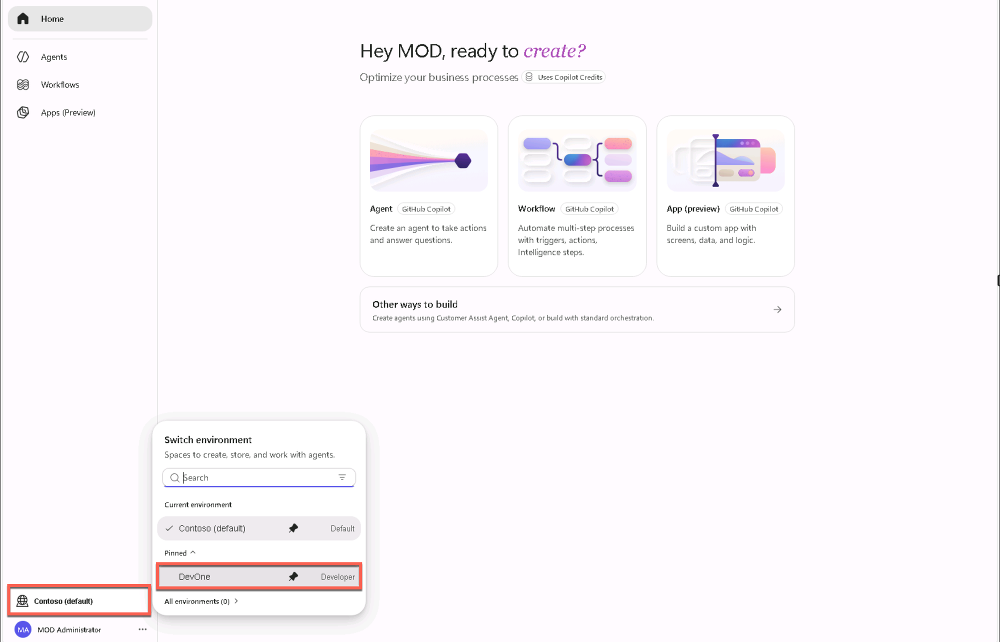
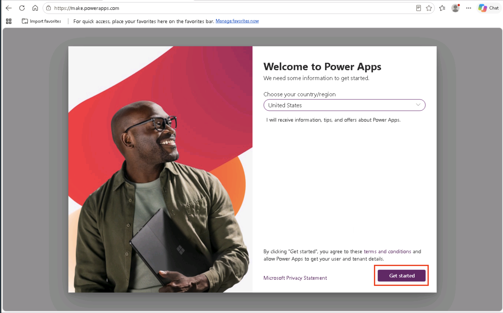
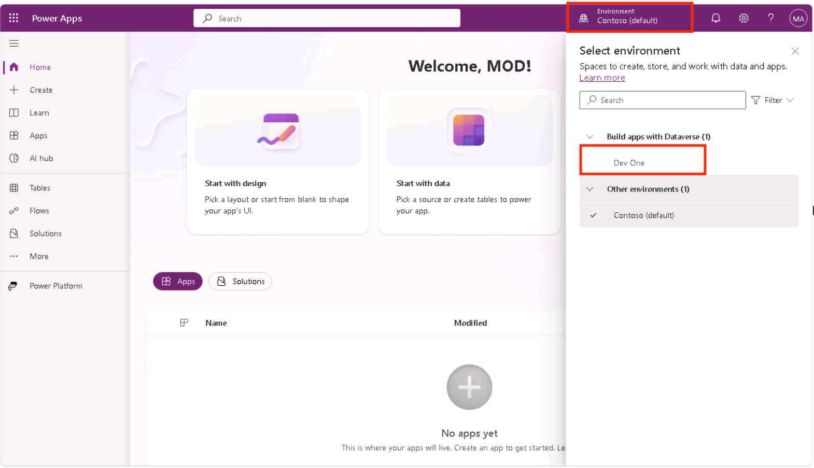
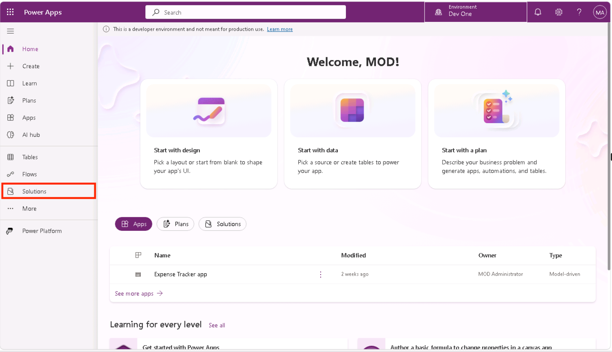
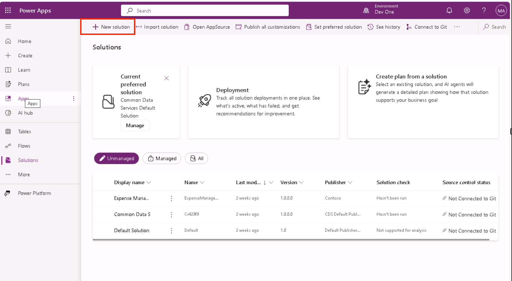
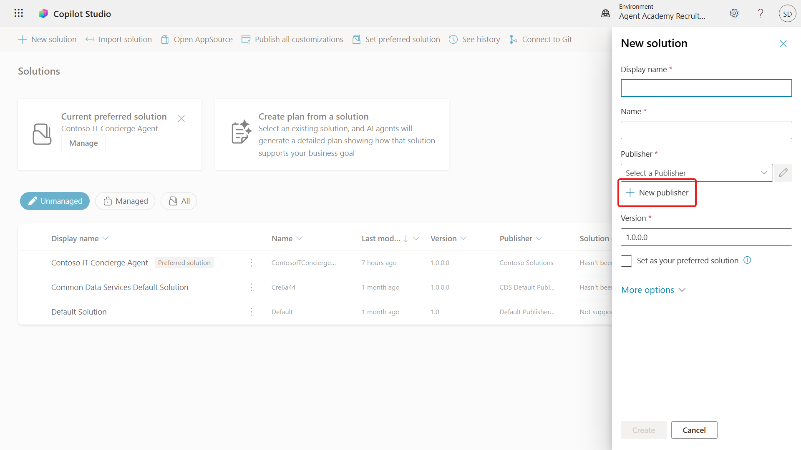
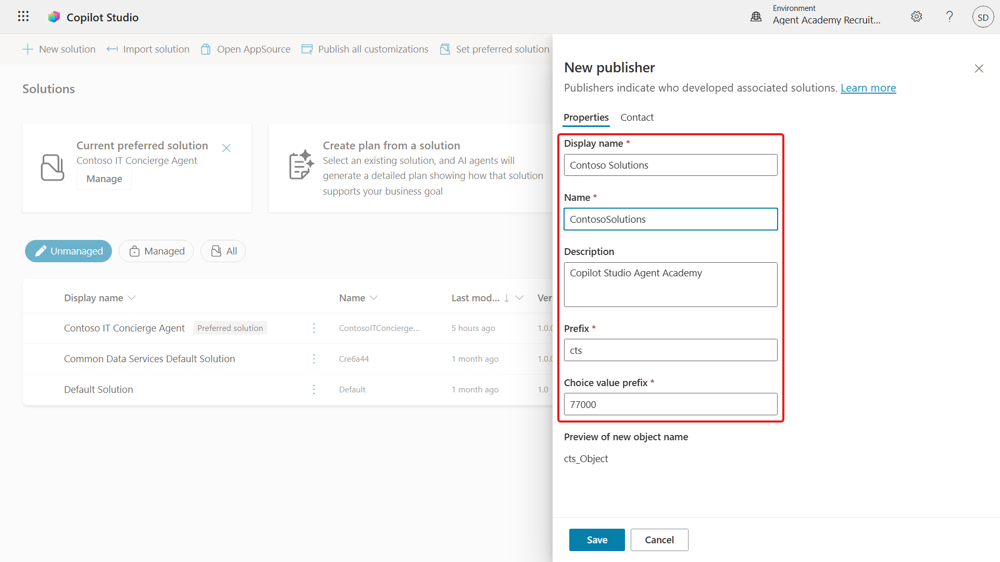
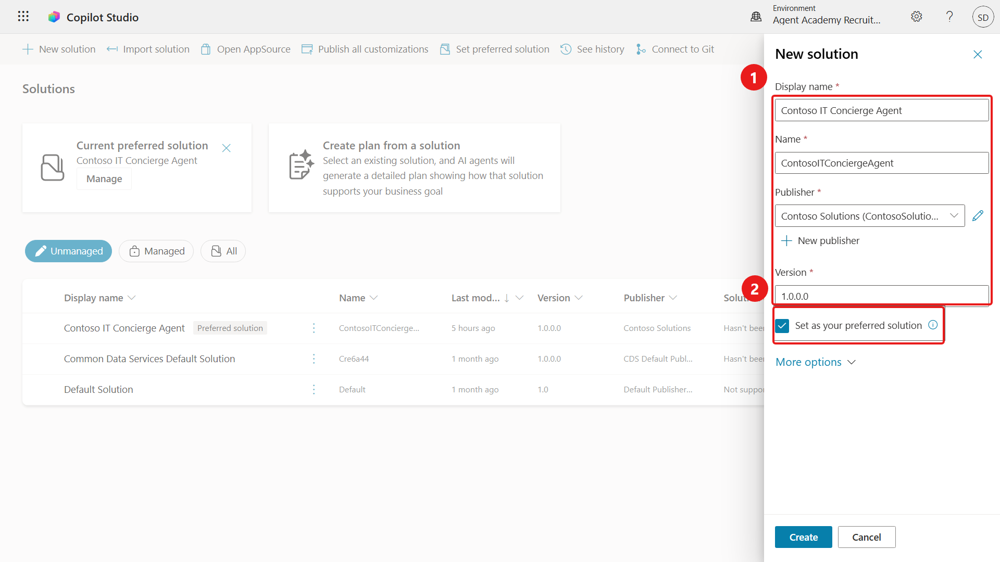
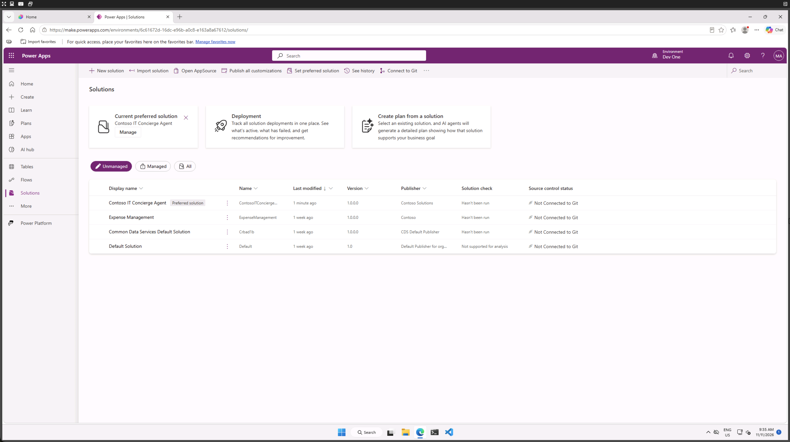

# 1 - Create a solution

A Power Platform solution groups related components so they can move together between environments. You'll work in an **unmanaged** solution for development. A **publisher** identifies component ownership and supplies a prefix.

## Log in

1. Open Microsoft Edge Browser (the Internet icon on the VM desktop) in your virtual machine and go to +++https://copilotstudio.microsoft.com+++.
1. Sign in with the username and TAP from the **Resources** tab.
1. Select the environment dropdown in the bottom left-hand corner and choose the **Dev One** environment.

    

## Create the publisher

1. Open a new tab and go to +++https://make.powerapps.com+++.
1. Select **Get started** if you see this **Welcome to Power Apps** screen.

    

1. Select the **Environment** picker in the **upper right-hand corner** and switch to the **Dev One** environment.

    

1. Select the **Solutions** tab in the **left navigation**.

    

1. In **Solution Explorer**, select **+ New solution**.

    

1. In the **New solution** pane, select **+ New publisher**.

    

1. On **Properties**, enter the following values:

    | Field | Value |
    | --- | --- |
    | Display name | +++Contoso Solutions+++ |
    | Name | +++ContosoSolutions+++ |
    | Description | +++Microsoft Ignite 2026 PREL36+++ |
    | Prefix | +++cts+++ |
    | Choice value prefix | Keep the automatically generated value |

    

1. Select **Save**.
1. Confirm that **Contoso Solutions** is selected in the **Publisher** dropdown in **New solution** pane.

## Create and prefer the solution

1. Enter the following values:

    | Field | Value |
    | --- | --- |
    | Display name | +++Contoso IT Concierge Agent+++ |
    | Name | +++ContosoITConciergeAgent+++ |
    | Version | `1.0.0.0` |
    | Publisher | `Contoso Solutions` |

1. Select **Set as your preferred solution**. This keeps newly created components in the intended solution.

    

1. Leave optional fields under **More options** blank.
1. Select **Create**.
1. After the empty solution opens, select the **back arrow** to return to Solution Explorer.
1. Confirm that **Contoso IT Concierge Agent** appears as the **Current preferred solution**.

    

    If a different solution is shown, select **Set preferred solution**, choose **Contoso IT Concierge Agent**, and select **Apply**. Skip this action if the correct solution is already preferred.

1. Close the Power Apps tab and return to the tab with Copilot Studio.

Select **Next** to build the agent.
