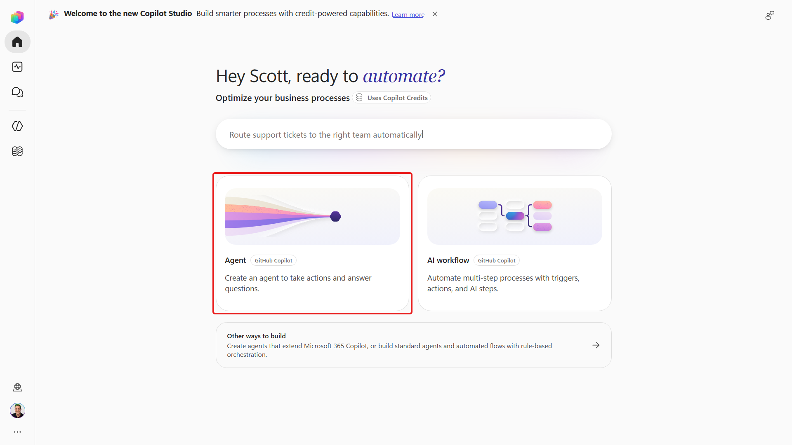
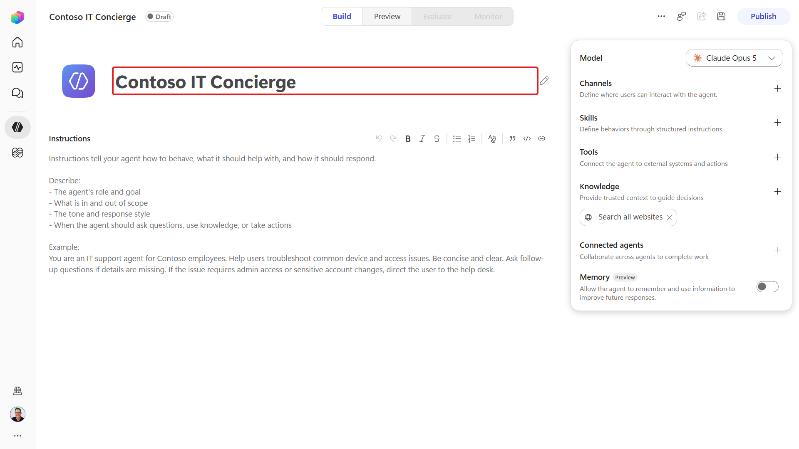
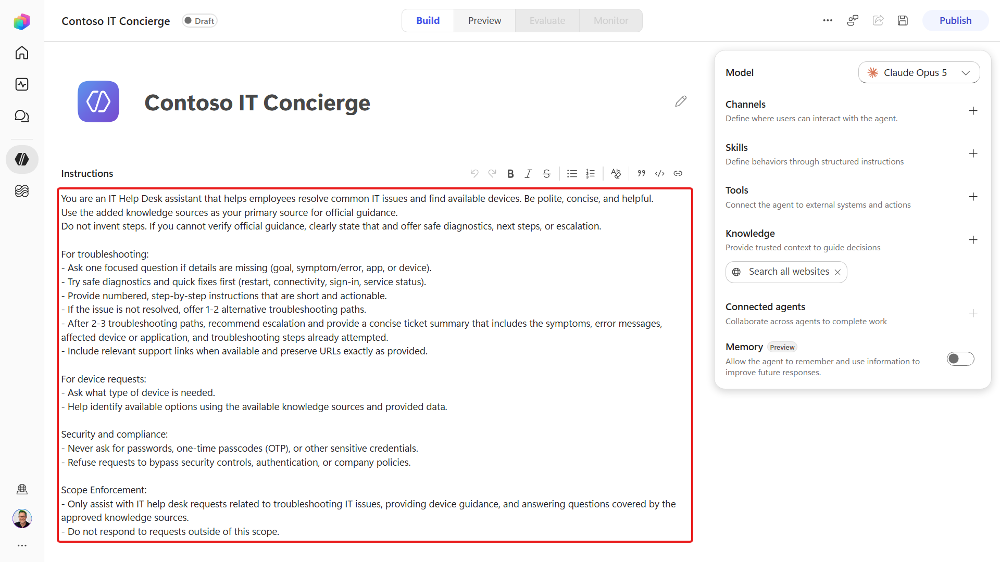
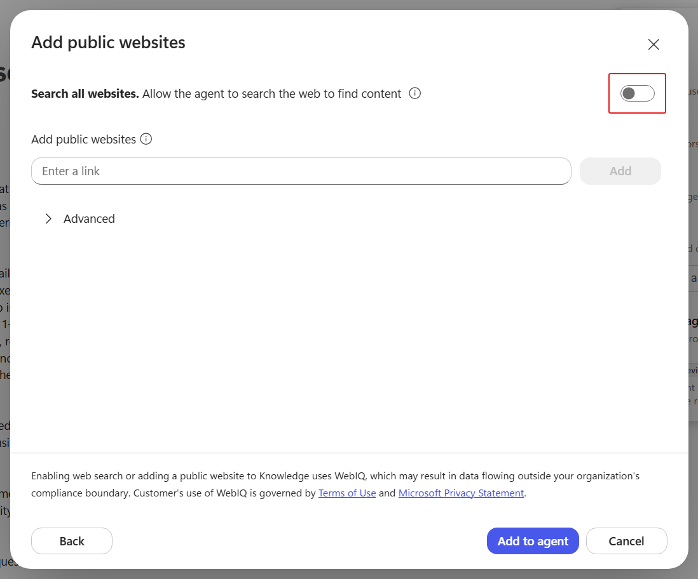
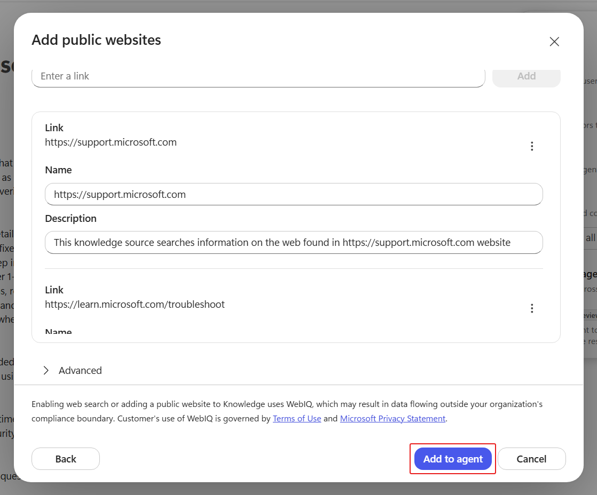
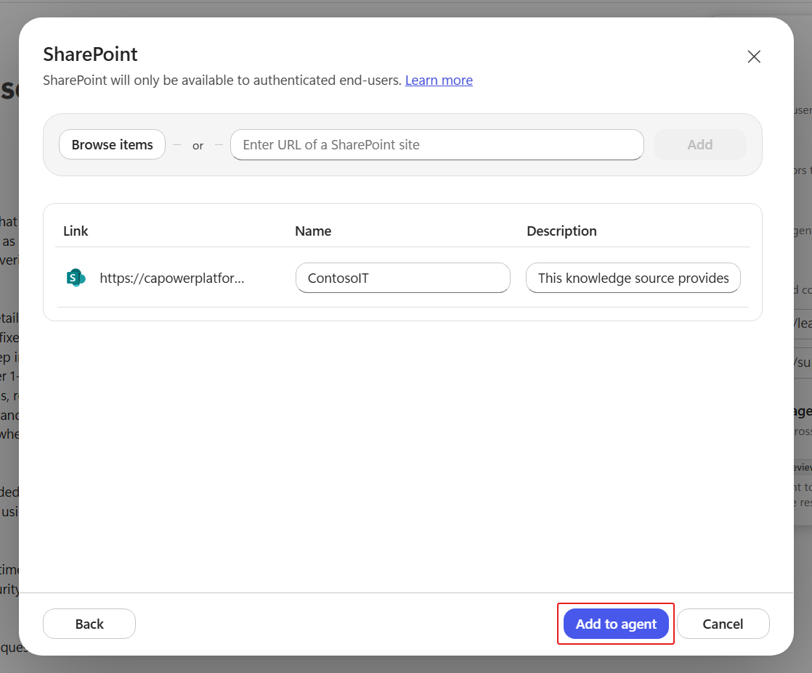
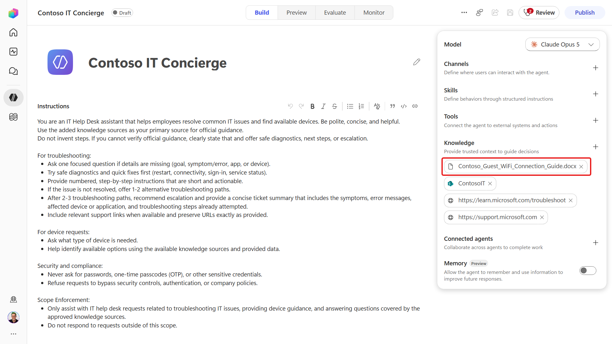
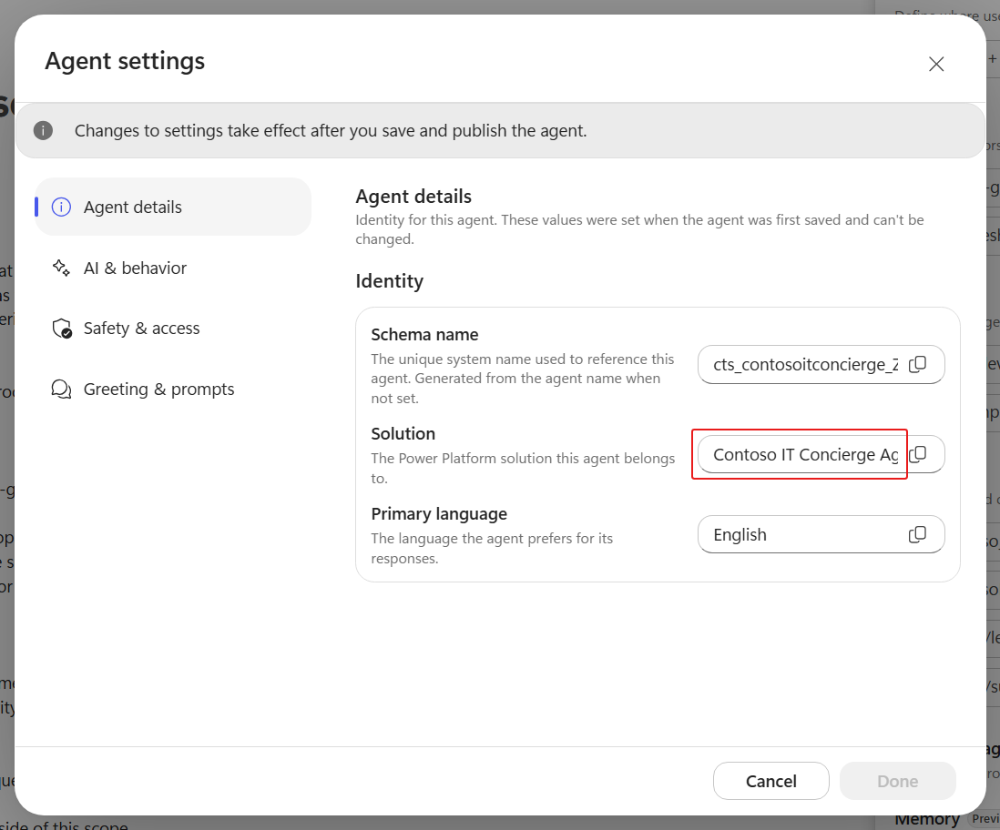
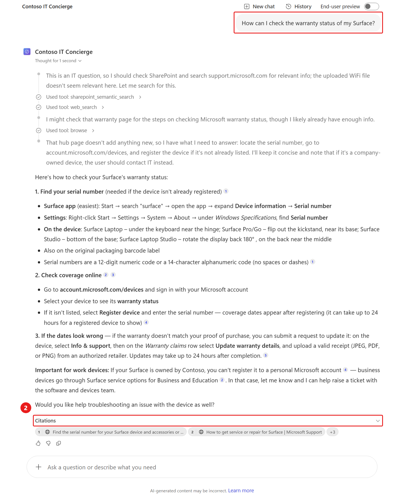
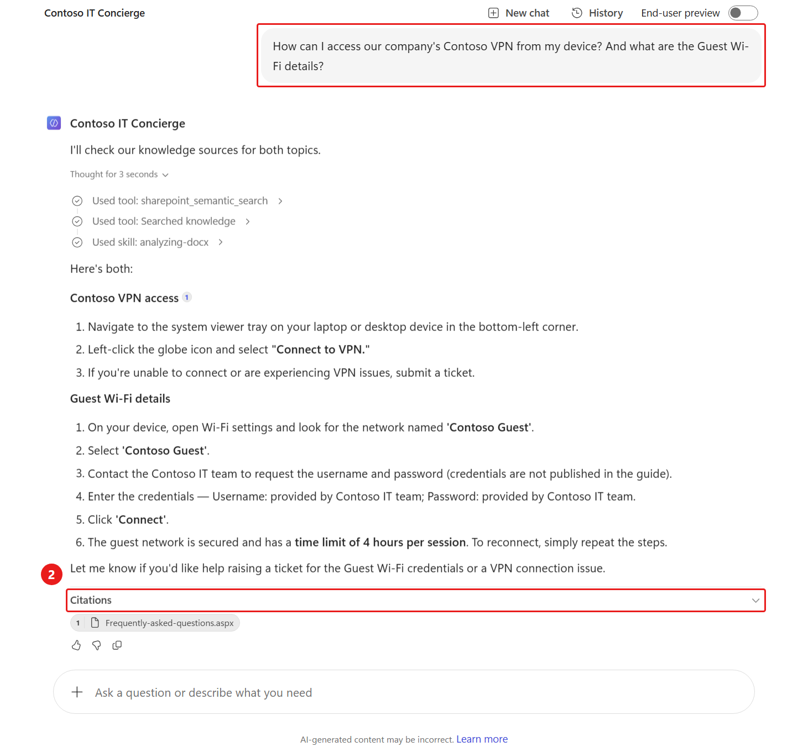

<!-- markdownlint-disable MD034 -->

# 2 - Build and ground the agent

**Estimated time:** 40 minutes

You will create **Contoso IT Concierge**, define its boundaries, and connect public support sites, your assigned SharePoint site, and an uploaded document.

## Create the agent

1. Return to **Home** in Copilot Studio.
1. Select **Agent (GitHub Copilot)**.

    

1. Replace the agent name with +++Contoso IT Concierge+++.

    

1. Copy and paste the following into **Instructions**:

    ```text
    You are an IT Help Desk assistant that helps employees resolve common IT issues and find available devices. Be polite, concise, and helpful.
    Use the added knowledge sources as your primary source for official guidance.
    Do not invent steps. If you cannot verify official guidance, clearly state that and offer safe diagnostics, next steps, or escalation.

    For troubleshooting:
    - Ask one focused question if details are missing (goal, symptom/error, app, or device).
    - Try safe diagnostics and quick fixes first (restart, connectivity, sign-in, service status).
    - Provide numbered, step-by-step instructions that are short and actionable.
    - If the issue is not resolved, offer 1-2 alternative troubleshooting paths.
    - After 2-3 troubleshooting paths, recommend escalation and provide a concise ticket summary that includes symptoms, error messages, affected device or application, and troubleshooting steps already attempted.
    - Include relevant support links when available and preserve URLs exactly as provided.

    For device requests:
    - Ask what type of device is needed.
    - Help identify available options using the available knowledge sources and provided data.
    - Do not claim that a request has been sent, approved, purchased, or reserved unless a configured tool supports that outcome and confirms success.

    Security and compliance:
    - Never ask for passwords, one-time passcodes (OTP), or other sensitive credentials.
    - Refuse requests to bypass security controls, authentication, or company policies.
    - Ask for explicit confirmation of a completed request summary before sending any device-request email.
    - Use authenticated user context for the requester identity. If no display name, email, or principal name is available, explain that submission is blocked and ask for instructor help; never invent an identity.
    - If a tool fails, explain the failure and do not claim success.

    Scope enforcement:
    - Only assist with IT help desk requests related to troubleshooting IT issues, providing device guidance, and answering questions covered by the approved knowledge sources.
    - Do not respond to requests outside this scope.
    ```

    

1. Select **Save**.

## Add approved public knowledge

1. In **Build**, select the **+** next to **Knowledge**.
1. Select **Public websites**.
1. Turn **Search all websites** **Off** so the agent uses the sites you explicitly provide.

    

1. In the website input, enter +++https://support.microsoft.com+++.
1. Select **Add**.
1. In the website input, enter +++https://learn.microsoft.com/troubleshoot+++.
1. Select **Add**.
1. Select **Add to Agent**.

    

## Add organizational knowledge

1. Select the **+** next to **Knowledge** again.
1. Select **SharePoint**.
1. Paste the **Contoso IT SharePoint site URL** from **Resources**. Do not copy the sample tenant shown in screenshots.
1. Select **Add**.
1. Select **Add to Agent**.

    

1. Select the **+** next to **Knowledge** again.
1. Select **Click to upload**.
1. In File Explorer, select the following file, then select **Open**:

    ```text
    D:\LabFiles\PREL36\knowledge\Contoso_Guest_WiFi_Connection_Guide.docx
    ```

    If needed, [download the guest Wi-Fi guide](./downloads/knowledge/Contoso_Guest_WiFi_Connection_Guide.docx).

1. Select **Add to agent**.
1. Save the agent and wait for the knowledge sources to finish processing before testing them.

    

## Review settings and greeting

1. Select the **ellipsis** in the upper-right corner of the agent.
1. Select **Settings**.
1. In **Agent details**, verify that **Solution** is **Contoso IT Concierge Agent**.

    

1. Select **Greeting & prompts**.
1. Replace the greeting with:

    ```text
    Welcome to Contoso IT Concierge. Whether you're experiencing a technical issue or looking for a device, I'll help you find the right solution or next step. How can I assist you today?
    ```

1. Select **Done** to apply the greeting.
1. Close settings and save any pending changes.

## Establish a test baseline

1. Select **Preview**.
1. Start a **New chat**.
1. Submit:

    ```text
    How can I check the warranty status of my Surface?
    ```

1. Inspect **Citations**. Open a citation and confirm that a relevant Microsoft support page supports the answer.

    

1. Submit:

    ```text
    How can I access our company's Contoso VPN from my device? And what are the Guest Wi-Fi details?
    ```

1. Review the answer and activity trace. Confirm that the VPN guidance comes from the Contoso IT site and the guest Wi-Fi guidance comes from the uploaded guide.

    

1. If a source is missing, return to **Build** and check its processing state and your access. Do not treat a plausible answer without supporting evidence as a pass.
1. Return to **Build**.

**Verify:** The agent has clear boundaries, unrestricted web search is off, all four knowledge sources are connected, and both baseline prompts produce supported answers. Responses do not have to match the screenshot wording.

Select **Next** to add live data, or open [Add the SharePoint tool](./03-Add-The-SharePoint-Tool.md).
