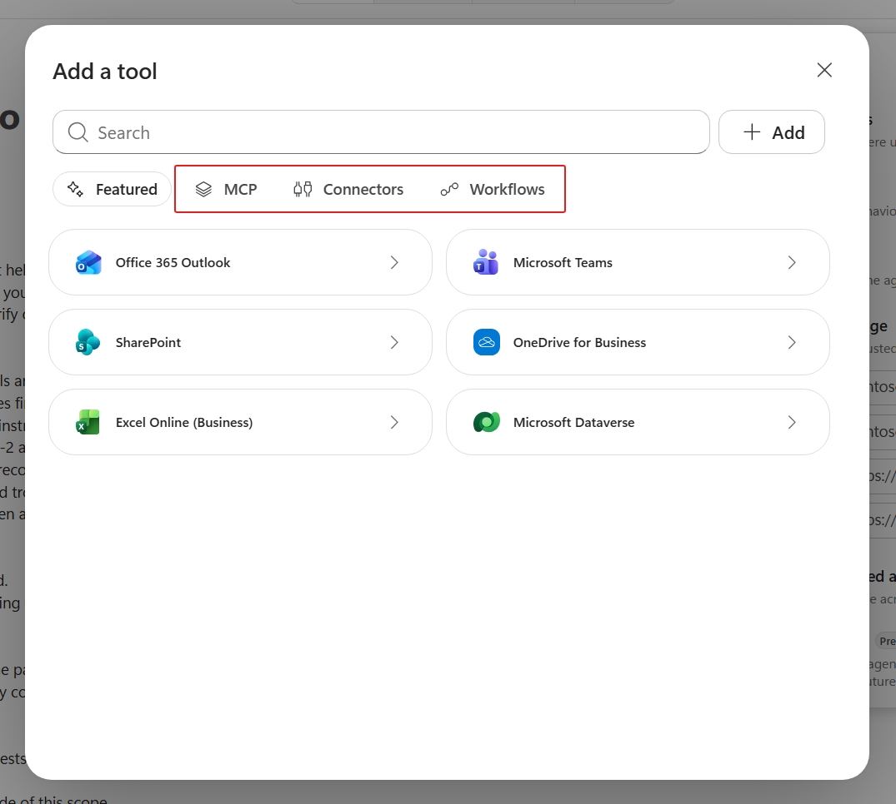
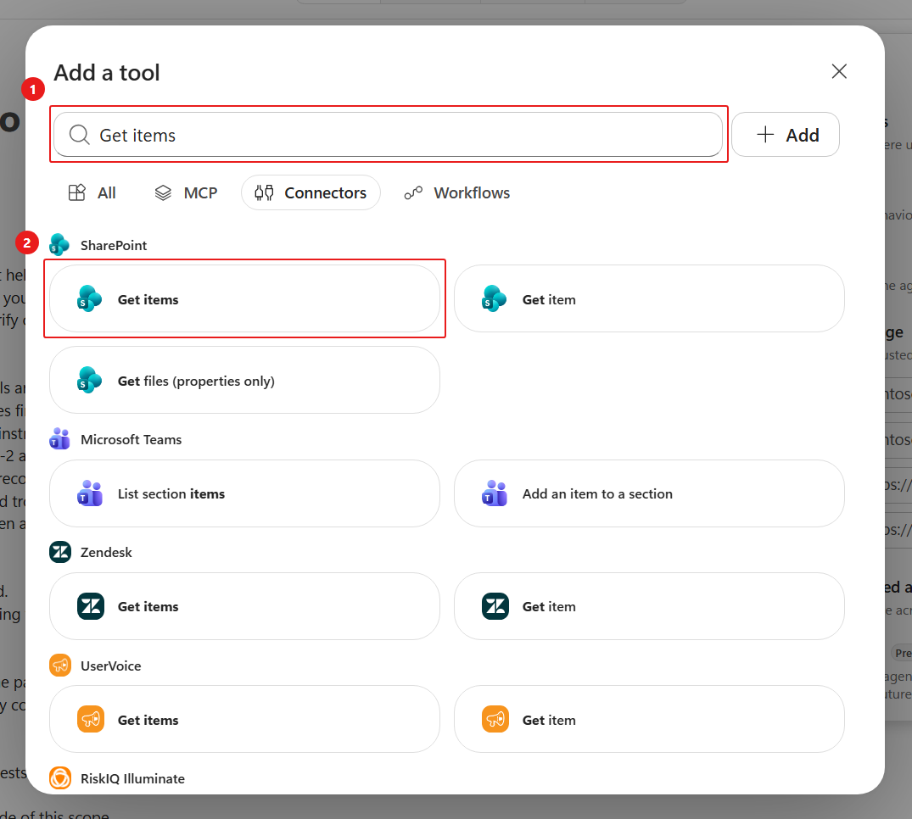
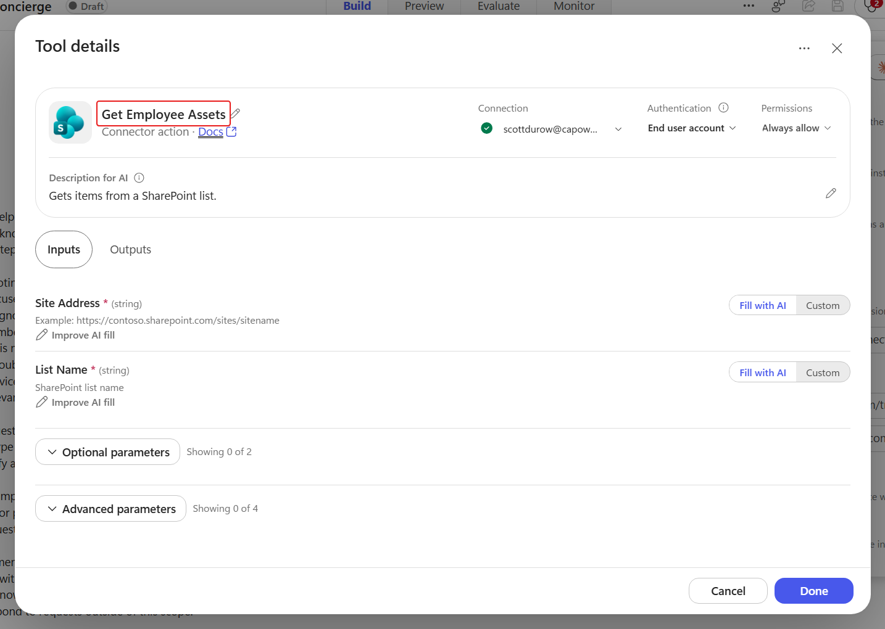
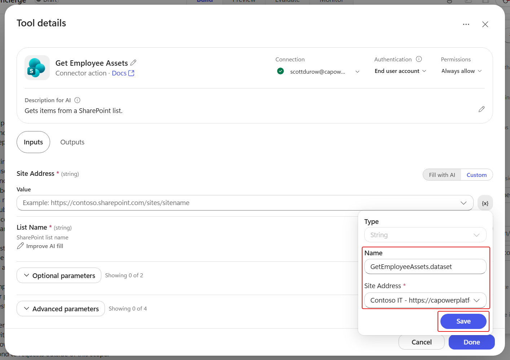
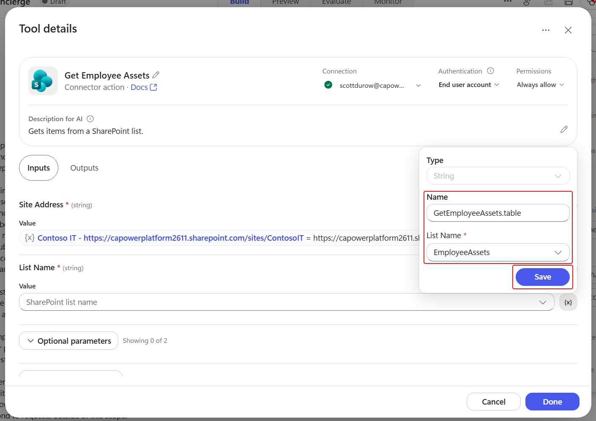

# 3 - Add the SharePoint tool

**Estimated time:** 20 minutes

Knowledge explains policy. A connector tool retrieves current records. You will add one read operation, **SharePoint - Get items**, and pin it to your assigned **EmployeeAssets** list.

## Add the connector

1. In the agent's **Build** tab, select the **+** next to **Tools**.
1. In **Add a tool**, select **Connectors**.

    

1. Search for +++Get items+++.
1. Select **Get items** from the **SharePoint** connector. Do not select **Get item**, which retrieves a single record and will be used later inside the workflow.

    

1. If a connection is required, create or select a SharePoint connection using your assigned lab account.
1. Select **+ Add**.

## Pin the tool to the lab list

1. Under **Tools**, select **Get items** to open **Tool details**.
1. Select the pencil next to the tool name.
1. Rename it +++Get Employee Assets+++. Keep this name exact; the supplied skills reference it.

    

1. Review the description. It should describe retrieving items from the configured SharePoint list, rather than approving or submitting a request.
1. Select **Inputs**.
1. For **Site Address**, change **How is this filled?** from **Fill with AI** to **Custom**.
1. In **Value**, select **New**.
1. Select your assigned **Contoso IT** site.
1. Select **Save**.

    

1. For **List Name**, change **How is this filled?** to **Custom**.
1. In **Value**, select **New**.
1. Select **EmployeeAssets**.
1. Select **Save**.

    

1. Leave query inputs such as **Filter Query** available for the agent to fill. The next section's skill defines the internal column names.
1. Select **Done** to save the tool configuration.
1. Save the agent.

## Check the live-data path

1. Select **Preview** and start a **New chat**.
1. Submit:

    ```text
    Use Get Employee Assets to list the current device records. Do not submit a request or send email.
    ```

1. Approve the connector permission prompt if one appears for your assigned SharePoint connection.
1. Inspect the activity trace. Confirm that **Get Employee Assets** ran successfully against **EmployeeAssets**.
1. Compare at least one returned model and its availability with the SharePoint list.
1. If the tool returns an access or configuration error, inspect the connection, fixed site, and fixed list before proceeding. A knowledge-source answer is not a successful tool test.
1. Return to **Build**.

**Verify:** **Get Employee Assets** retrieves records from the intended list. The agent cannot choose a different site or list through these fixed inputs.

Take the first **10-minute break**. Then select **Next**, or open [Add and refine skills](./04-Add-And-Refine-Skills.md).
