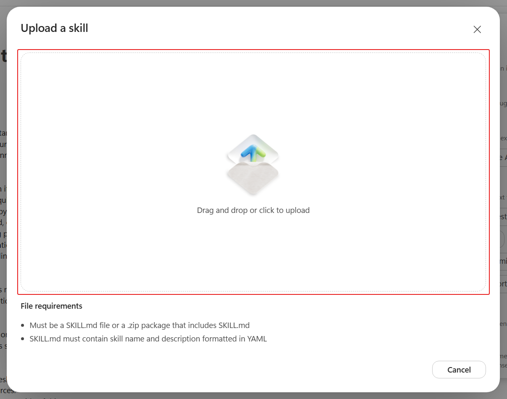
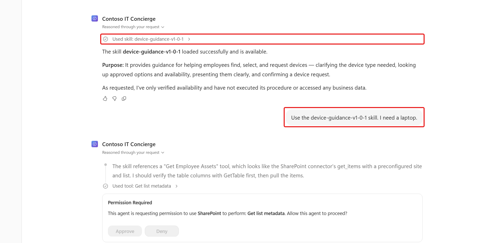
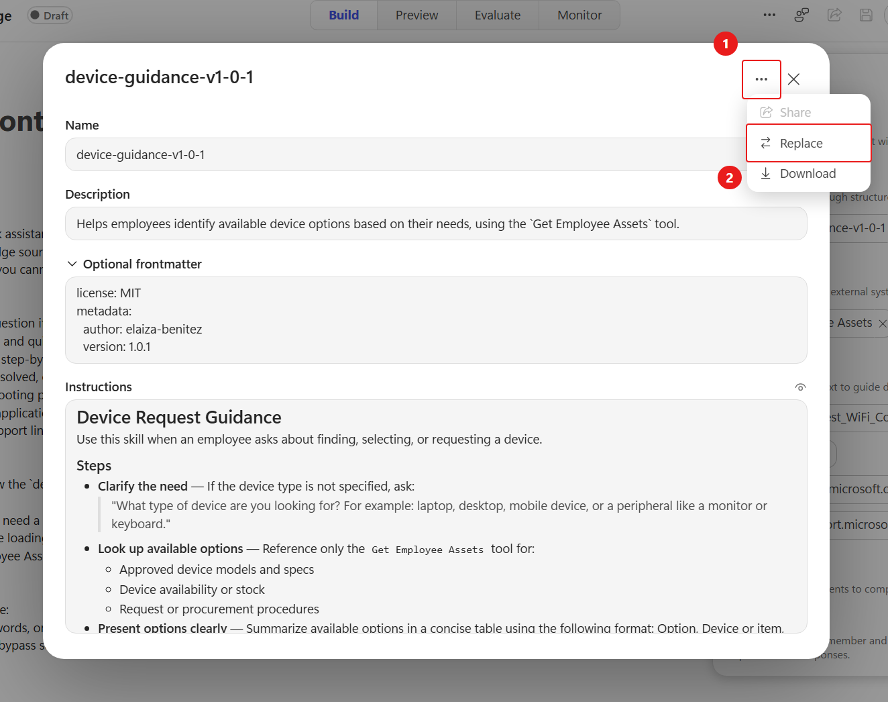
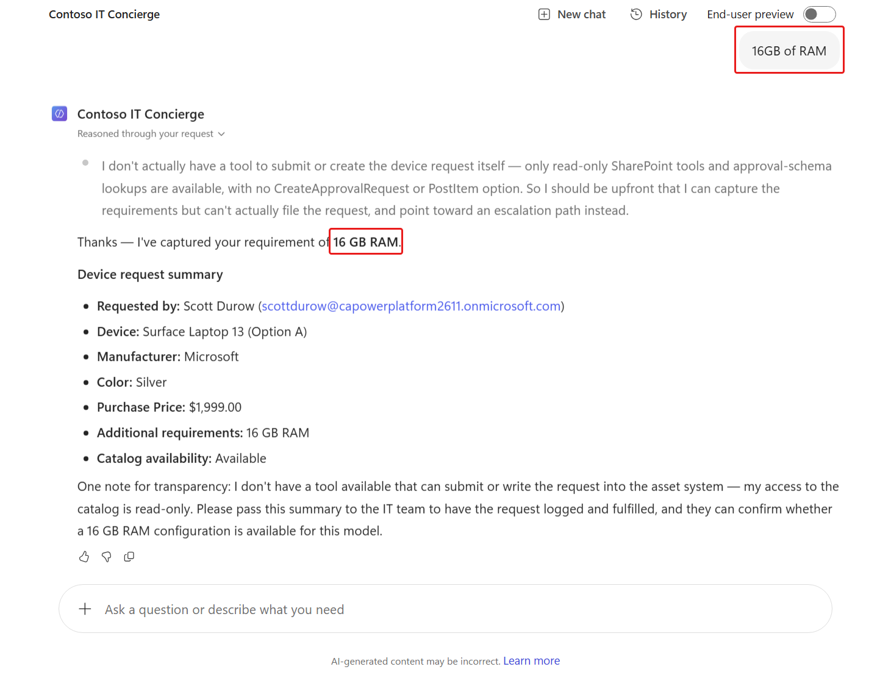
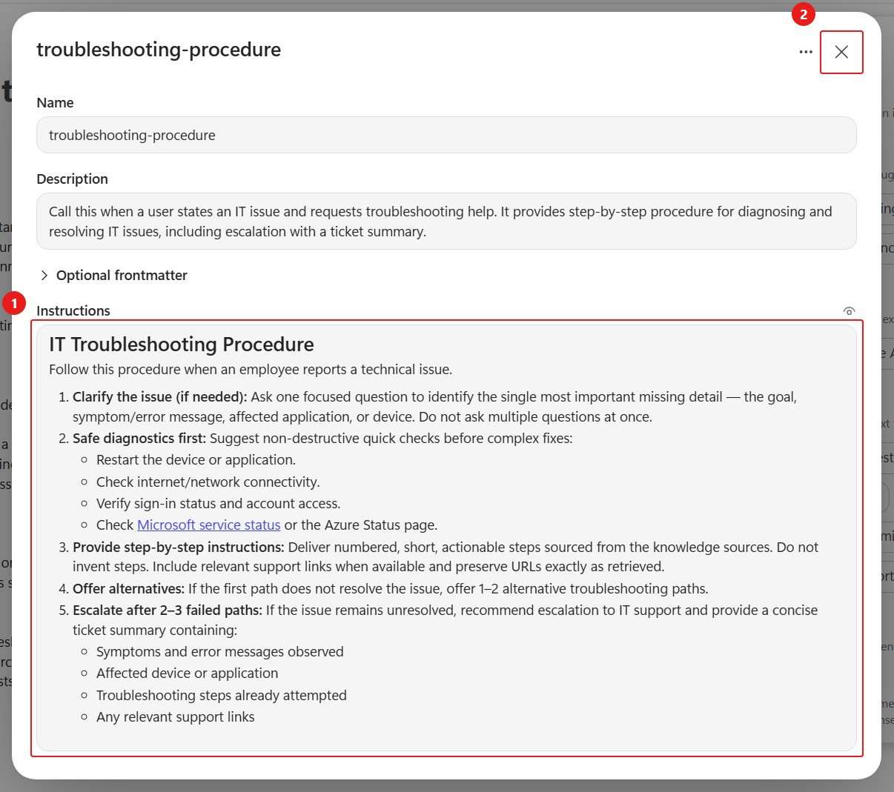

# 4 - Add and refine skills

**Estimated time:** 40 minutes

A skill packages a name, description, and focused procedure in `SKILL.md`. The harness uses the description to choose the skill; its instructions define what to collect, which tools to call, and when to stop.

You will compare two versions of the device guidance skill and add a troubleshooting skill. The four-hour path skips the intermediate v1.0.2 upload but preserves the schema-mapping lesson.

## Add the initial device skill

1. In **Build**, select the **+** next to **Skills**.
1. Select **Upload a skill**.
1. Upload:

    ```text
    D:\LabFiles\PREL36\skills\device-guidance-v1-0-1\SKILL.md
    ```

    If needed, [download the initial SKILL.md](./downloads/skills/device-guidance-v1-0-1/SKILL.md). Keep the filename `SKILL.md` and its parent folder so different versions do not overwrite one another.

    

1. Open the uploaded skill and review its name, description, use of **Get Employee Assets**, lettered device options, and mapping from each option to a SharePoint item ID.
1. Close the skill panel.
1. In the agent instructions, replace all existing bullets under **For device requests:** with:

    ```text
    - Refer to the `device-guidance-v1-0-1` skill.
    - Do not claim that a request has been sent, approved, purchased, or reserved unless a configured tool supports that outcome and confirms success.
    ```

1. Keep the other instruction sections, including the explicit-confirmation and tool-failure rules.
1. Save the agent.

## Test the initial procedure

1. Select **Preview** and start a **New chat**.
1. Submit this availability-only check:

    ```text
    Load only the device-guidance-v1-0-1 skill and confirm its name and purpose. Do not run its procedure, read or change business data, create files, send messages, or call other tools. If it is unavailable, say so without using a substitute.
    ```

1. Inspect the trace for the exact skill name. If it is unavailable, verify the saved upload and retry after the configuration has settled.
1. In the same conversation, submit:

    ```text
    Use the device-guidance-v1-0-1 skill. I need a laptop.
    ```

1. Confirm that the device lookup calls **Get Employee Assets** and returns list-backed device options.

    

1. Inspect the tool inputs. If a query error occurs, check whether the model guessed a display name such as **Asset Type** instead of using the column's internal name. An error is possible, not guaranteed; do not deliberately cause one.

## Replace it with the refined version

1. Return to **Build** and open **device-guidance-v1-0-1**.
1. Select the skill's **ellipsis**, then **Replace**.
1. Upload:

    ```text
    D:\LabFiles\PREL36\skills\device-guidance-v1-0-3\SKILL.md
    ```

    If needed, [download the refined SKILL.md](./downloads/skills/device-guidance-v1-0-3/SKILL.md).

    

1. Review the explicit internal column mappings and the new step for additional requirements.

    | Display name | Expected internal name in the prepared list |
    | --- | --- |
    | Status | `field_1` |
    | Manufacturer | `field_2` |
    | Model | `field_3` |
    | Asset Type, called Device Type in the skill | `field_4` |
    | Color | `field_5` |

    The exact mappings belong to this sample list, not every SharePoint list. To verify a column, open **Settings** > **List settings**, select the column, and inspect the `Field` parameter in the URL. For example, `field%5F4` decodes to `field_4`.

    > [!IMPORTANT]
    > If your list uses different internal names, ask your instructor to correct the prepared list or the local skill mappings before continuing. Do not keep retrying an invalid filter.

1. In the agent instructions, update the device skill reference:

    ```text
    - Refer to the `device-guidance-v1-0-3` skill.
    ```

1. Keep the existing no-false-submission bullet and save the agent.
1. In **Preview**, start a **New chat**.
1. Repeat the availability-only check, replacing `device-guidance-v1-0-1` with `device-guidance-v1-0-3`.
1. In that verified conversation, submit:

    ```text
    Use the device-guidance-v1-0-3 skill. I need a laptop.
    ```

1. Confirm the trace references v1.0.3 and **Get Employee Assets**. Inspect the filter if one is used.
1. Choose a letter corresponding to an available laptop in the actual response, for example +++A+++.
1. When asked for additional requirements, submit:

    ```text
    16GB of RAM
    ```

1. Confirm the summary includes the selected model and your additional requirement.

    

1. Confirm that no request email was sent. You have not connected a submission workflow yet.

## Add a troubleshooting skill

1. In **Build**, select the **+** next to **Skills**.
1. Select **Upload a skill**.
1. Upload:

    ```text
    D:\LabFiles\PREL36\skills\it-troubleshooting-procedure\SKILL.md
    ```

    If needed, [download the troubleshooting SKILL.md](./downloads/skills/it-troubleshooting-procedure/SKILL.md).

1. Review the uploaded skill. Its internal name is **troubleshooting-procedure**, even though its download folder is named **it-troubleshooting-procedure**.

    

1. In the agent instructions, replace the existing bullets under **For troubleshooting:** with:

    ```text
    - Refer to the `troubleshooting-procedure` skill.
    ```

1. Keep the global grounding, security, and scope instructions.
1. Save the agent.
1. In **Preview**, start a **New chat** and submit:

    ```text
    I'm not getting new emails anymore.
    ```

1. Confirm that **troubleshooting-procedure** is invoked and the agent asks a focused follow-up question.
1. Continue the simulated conversation using these replies when relevant:

    ```text
    Happening on both Outlook on Windows and Outlook mobile on my iOS device.
    ```

    ```text
    The Windows Outlook status bar is showing working offline.
    ```

    ```text
    That fixed it, I'm receiving email now!
    ```

1. Confirm the agent offers safe, grounded steps and only treats the issue as resolved after your confirmation. You are simulating a support conversation; do not change account or security settings.

**Verify:** The agent uses the refined device skill and live list tool, captures additional requirements, and follows the troubleshooting procedure. Explicitly naming a skill verifies that version, not automatic routing; you will test natural-language routing later.

Take the second **10-minute break**. Then select **Next**, or open [Build the device-request workflow](./05-Build-The-Device-Request-Workflow.md).
