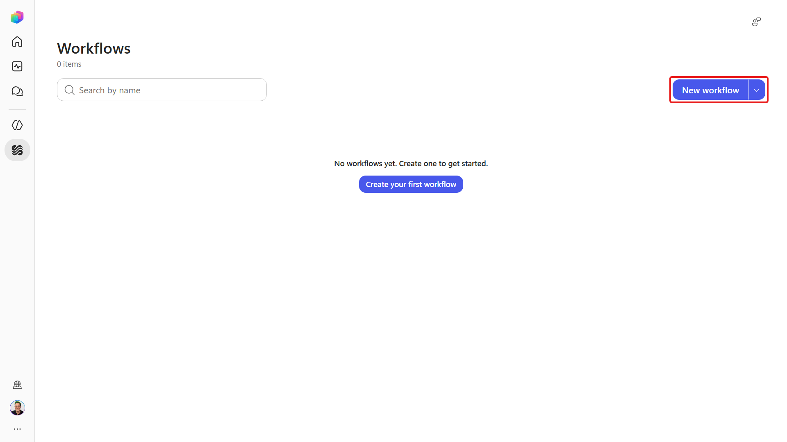
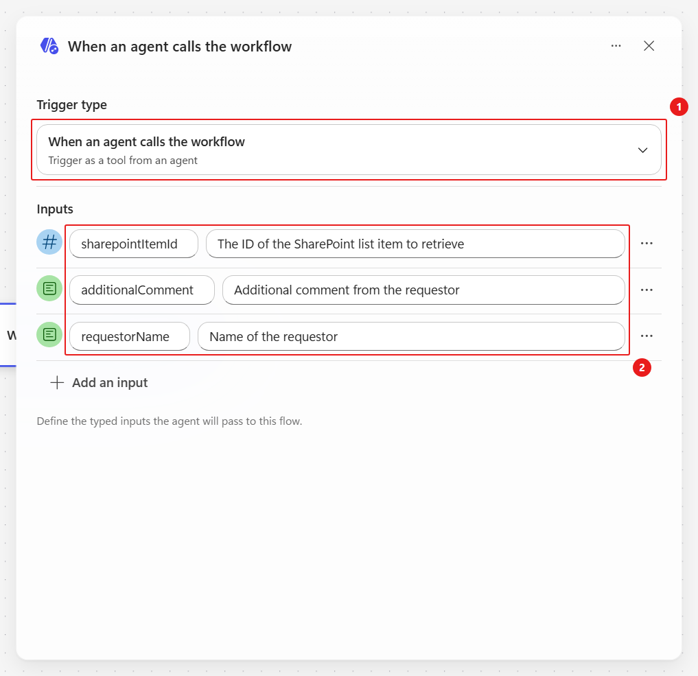
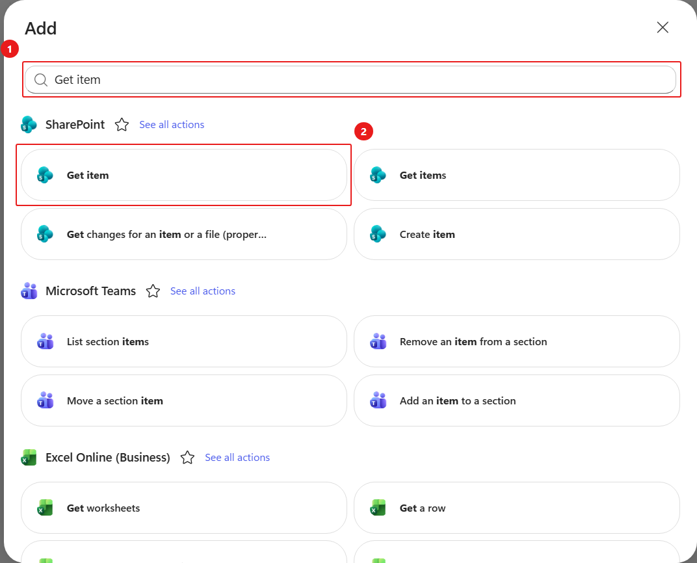
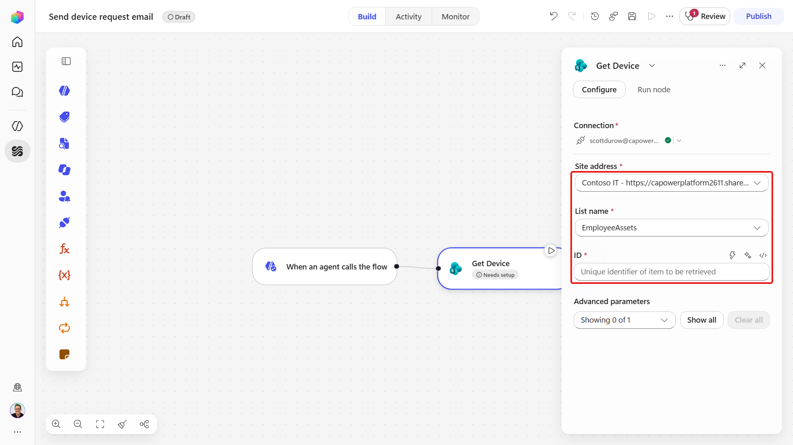
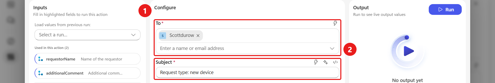
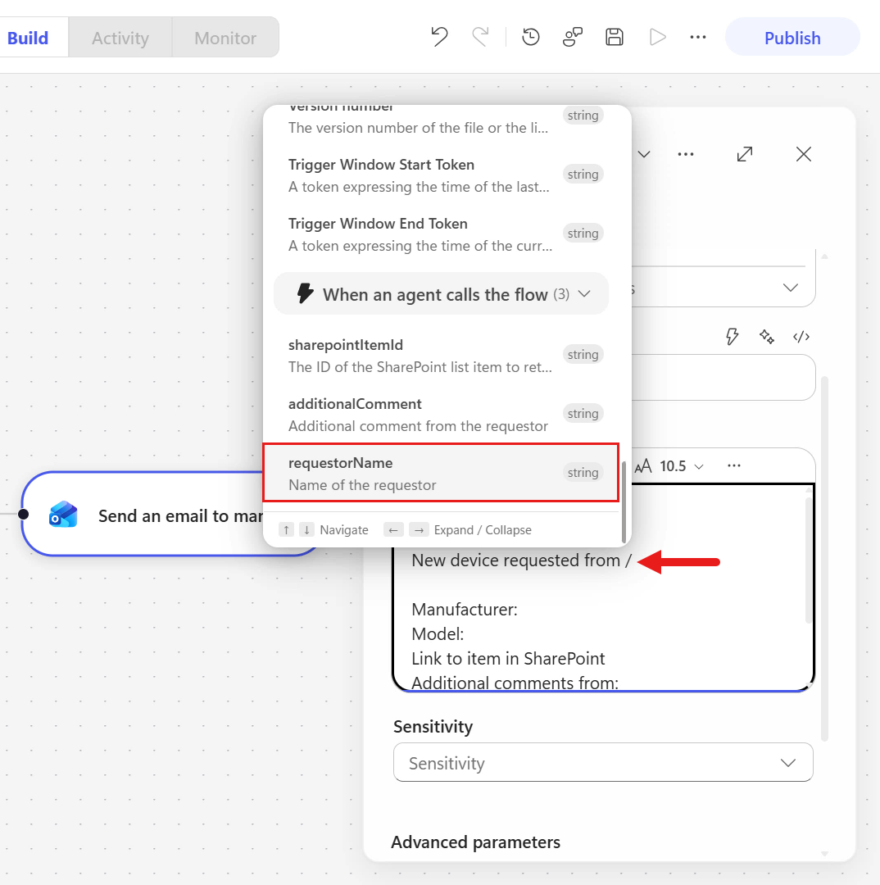
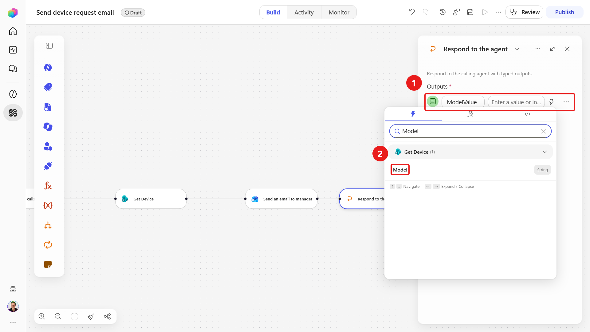
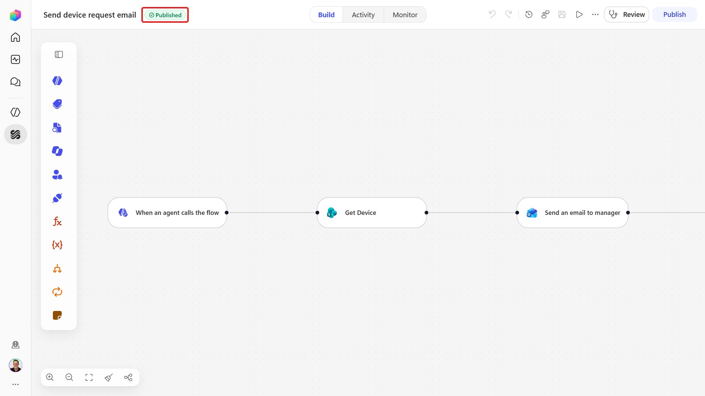
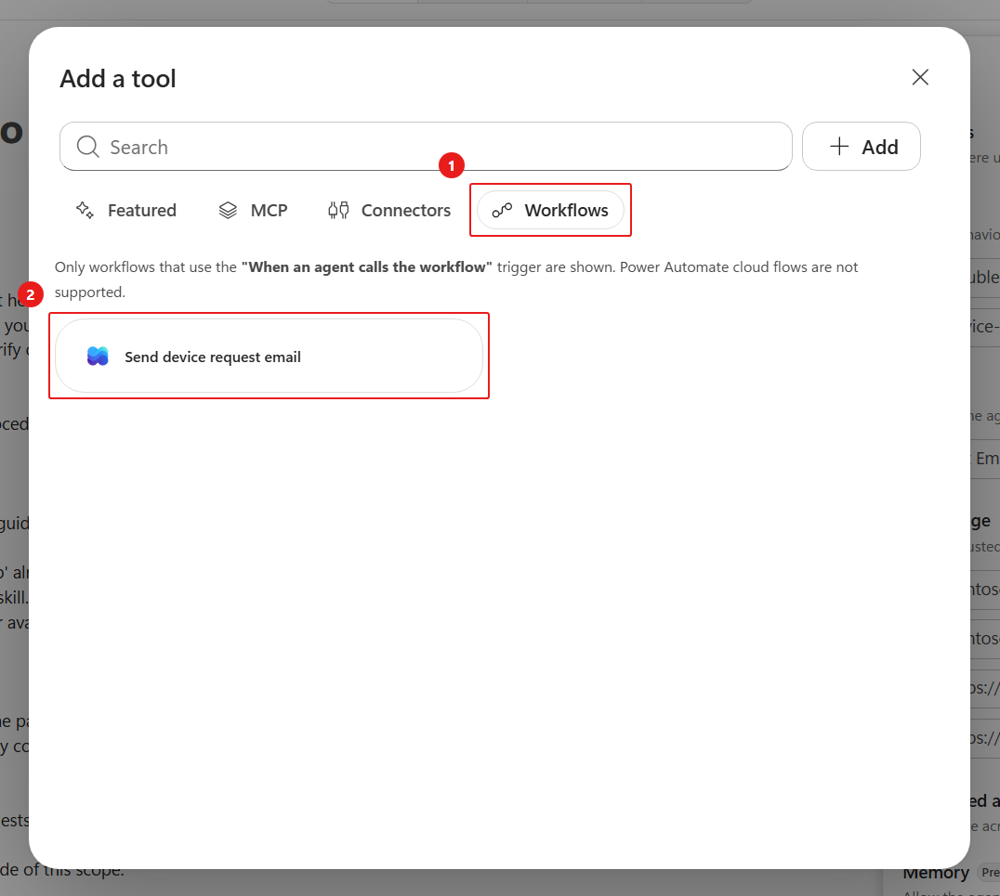

# 5 - Build the device-request workflow

**Estimated time:** 50 minutes

The agent gathers and interprets the request. A workflow executes the repeatable transaction: read one selected SharePoint item, send an email, and return its model to the agent.

> [!IMPORTANT]
> Use your own assigned lab mailbox as the recipient. Do not email a real manager or an external address. The workflow submits a request for review; it does not grant approval or reserve a device.

## Create the workflow and inputs

1. In Copilot Studio's left navigation, select **Workflows**.
1. Select **Create your first workflow** or **New workflow**.

    

1. Rename the workflow +++Send device request email+++. The final device skill references this exact tool name.
1. Select the **Start** trigger node.
1. Change the trigger type from **Manual** to **When an agent calls the workflow**.
1. Add three **Text** inputs with the following exact names and descriptions:

    | Input name | Description |
    | --- | --- |
    | `sharepointItemId` | The ID of the SharePoint list item to retrieve |
    | `additionalComment` | Additional comment from the requestor |
    | `requestorName` | Name of the requestor |

    

These inputs are the contract between the skill and workflow. The selected option's real SharePoint ID must be passed, not its letter or its position in a table.

## Retrieve the selected device

1. Select the **+** after the trigger.
1. Search for +++Get item+++.
1. Select **Get item** from the **SharePoint** connector. This is the singular action, not the earlier **Get items** list tool.

    

1. Rename the action +++Get Device+++.
1. Select or create the SharePoint connection using your assigned lab account.
1. Set **Site Address** to your assigned **Contoso IT** site.
1. Set **List Name** to **EmployeeAssets**.
1. In **Id**, select the **lightning bolt** icon.
1. Select **sharepointItemId** from the trigger's dynamic content. Do not type the name as literal text.
1. Select **Show all** to expose advanced parameters.
1. Set **Limit Columns by View** to **All Items**.

    

## Send the request to the lab mailbox

1. Select the **+** after **Get Device**.
1. Search for +++send an email+++.
1. Select **Send an email** from **Office 365 Outlook**. The connector action can appear as **Send an email (V2)**.
1. Rename the node +++Send an email to manager+++. You are simulating the manager handoff using your own mailbox.
1. For **Connection**, select **Create new connection** if necessary and sign in with your assigned lab account.
1. Set **To** to the **lab email address** in **Resources**.
1. Set **Subject** to +++Request type: new device+++.

    

1. Copy and paste the following into **Body**:

    ```text
    Hi,

    New device requested from

    Manufacturer:
    Model:
    Link to item in SharePoint:
    Additional comment:

    This is an automated email from Contoso IT Concierge. This lab request is for review only, not approval or procurement.
    ```

1. Place the cursor after each label and insert the corresponding **dynamic content** using the lightning bolt icon:

    | After this text | Insert this dynamic value | From |
    | --- | --- | --- |
    | New device requested from | `requestorName` | Trigger |
    | Manufacturer: | `Manufacturer Value`, or `Value` under Manufacturer | Get Device |
    | Model: | `Model` | Get Device |
    | Link to item in SharePoint: | `Link to item` | Get Device |
    | Additional comment: | `additionalComment` | Trigger |

    

1. Confirm the fields contain dynamic content tokens, not the literal words `requestorName`, `Model`, or `additionalComment`.
1. If your tenant requires a sensitivity label, use the label specified by your instructor. Do not assume the sample label in Agent Academy exists in your lab tenant.

> [!NOTE]
> For this timed lab, keep the email body simple. HTML hyperlink editing and cosmetic formatting are not required. A visible item URL is sufficient; copy it into the browser if your email client does not render it as a link.

## Return a result and publish

1. Select the **+** after the email node.
1. In the node palette, select **Agent**, then **Respond to the agent**.
1. Add or rename the text output to +++ModelValue+++.
1. Set its returned value to the **Model** dynamic content from **Get Device**.

    

1. Review the order:

    ```text
    When an agent calls the workflow
      -> Get Device
      -> Send an email to manager
      -> Respond to the agent
    ```

1. Select **Save**.
1. Review and resolve any errors in the workflow's **Health Center**.
1. Select **Publish**.
1. Wait until the workflow status is **Published**.

    

## Connect the workflow to the agent

1. Select **Agents** and open **Contoso IT Concierge**.
1. In **Build**, select the **+** next to **Tools**.
1. Select **Workflows**.
1. Select **Send device request email** and complete the add action if prompted.

    

1. Confirm the workflow appears in **Tools**.
1. Open **device-guidance-v1-0-3** under **Skills**.
1. Select its **ellipsis**, then **Replace**.
1. Upload:

    ```text
    D:\LabFiles\PREL36\skills\device-guidance-v1-0-4\SKILL.md
    ```

    If needed, [download the workflow-enabled SKILL.md](./downloads/skills/device-guidance-v1-0-4/SKILL.md).

1. Review the final skill. It collects requirements, asks for confirmation, obtains the requester name from authenticated user context, and passes the selected SharePoint item ID to the workflow.
1. Update the device skill reference under **For device requests:** in the agent instructions:

    ```text
    - Refer to the `device-guidance-v1-0-4` skill.
    ```

1. Keep the no-false-submission bullet and the global explicit-confirmation and tool-failure rules.
1. Save the agent.

> [!IMPORTANT]
> Do not replace an authenticated requester identity with a name guessed by the model. The supplied skill uses `User.DisplayName`, with `User.Email` or `User.PrincipalName` as fallbacks. If none is available, stop and ask the instructor to check authentication before testing a submission.

**Verify:** The published workflow has three correctly named text inputs, a real SharePoint item lookup, an email action targeting your lab mailbox, and the **ModelValue** return value. The agent has the workflow tool and v1.0.4 skill.

Select **Next** to test, or open [Test the solution end to end](./06-Test-End-To-End.md).
