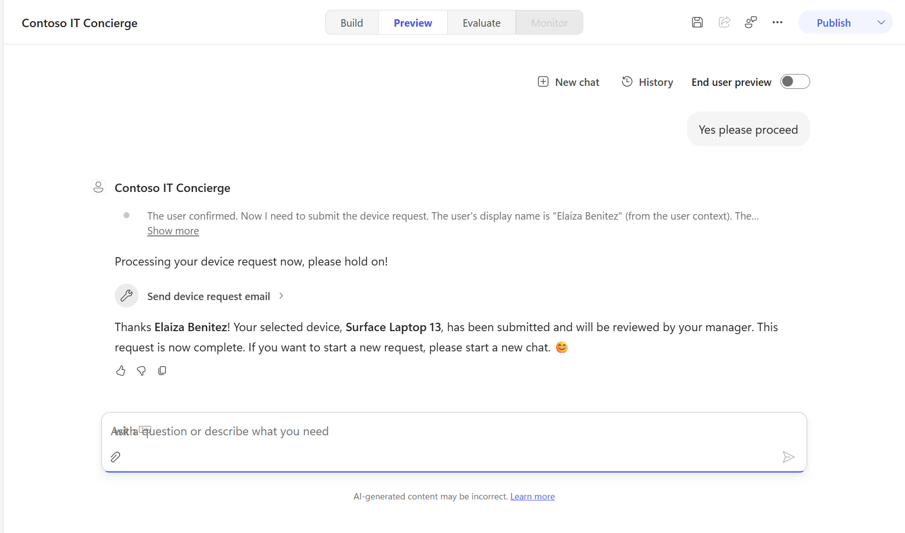
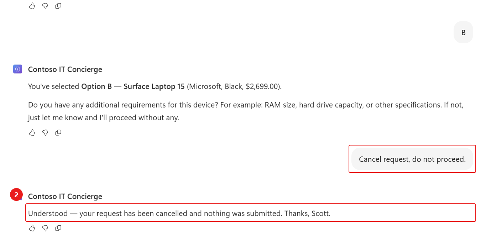

# 6 - Test the solution end to end

**Estimated time:** 20 minutes

Saving, publishing, and getting a plausible chat response do not prove the transaction is correct. Check the activity trace, workflow run, selected list item, and actual mailbox.

## Check skill readiness in each test conversation

1. Open the agent's **Preview** tab.
1. Select **New chat**.
1. Submit:

    ```text
    Load only the device-guidance-v1-0-4 skill and confirm its name and purpose. Do not run its procedure, read or change business data, create files, send messages, or call other tools. If it is unavailable, say so without using a substitute.
    ```

1. Confirm the exact skill in the trace. If it is unavailable, verify the saved skill and instructions before retrying.
1. Keep that verified conversation for the first scenario. Repeat this readiness check in the new conversation for each subsequent scenario.

> [!NOTE]
> Explicit skill names are a Preview diagnostic technique. They verify the intended version, not automatic selection from an ordinary user request.

## Test 1: Submit a request with requirements

1. In the verified conversation, submit:

    ```text
    Use the device-guidance-v1-0-4 skill. I need a new laptop.
    ```

1. Confirm the lookup calls **Get Employee Assets**. Device records from a knowledge search or uploaded workbook are not a substitute.
1. Choose a letter for an available laptop from the actual response, for example +++A+++.
1. When asked for requirements, submit:

    ```text
    16GB of RAM
    ```

1. Before confirming the request, check the trace and mailbox: the email workflow must not have run yet.
1. Verify the request summary identifies your selected device and additional requirement.
1. When asked to proceed, submit:

    ```text
    Yes please proceed.
    ```

1. Approve connection permissions if prompted for your lab resources.
1. Verify that **Send device request email** runs only after your confirmation.
1. In the workflow's **Activity** view, open the run. Check that **Get Device**, the email action, and **Respond to the agent** completed successfully.
1. Compare the input **sharepointItemId** with the item mapped to your selected letter, not the option's display position.
1. In Outlook, locate the new email with subject **Request type: new device**.
1. Verify the body contains your authenticated requester identity, the selected manufacturer and model, an item URL, and **16GB of RAM**.
1. Open or copy the item URL into the browser. Confirm it resolves to the selected **EmployeeAssets** record.
1. Confirm the agent's final response uses the returned model and says the request was submitted for review, not approved.

    

## Test 2: Submit without additional requirements

1. Start a **New chat** and complete the readiness check at the top of this section.
1. Submit:

    ```text
    Use the device-guidance-v1-0-4 skill. I need a new laptop.
    ```

1. Select a valid available option from the returned table.
1. When asked for requirements, submit +++None+++.
1. Confirm the request summary.
1. Submit +++Yes please proceed+++ when asked for approval to send.
1. Check the workflow run and the new email. **Additional comment** must contain **No additional requirements provided**, not a fabricated specification.
1. Verify the selected device and requester match this conversation.

## Test 3: Cancel before submission

1. Note the current workflow run count and the matching email count.
1. Start a **New chat** and complete the readiness check.
1. Submit:

    ```text
    Use the device-guidance-v1-0-4 skill. I need a new laptop.
    ```

1. Select a valid device option.
1. Submit:

    ```text
    Cancel request, do not proceed.
    ```

1. Confirm the agent ends the request without calling **Send device request email**.
1. Verify there is no new submission workflow run or email for the cancelled conversation. A read-only inventory lookup can still appear in the trace.

    

## Test 4: Natural-language routing

1. Start a **New chat** without sending the skill-readiness prompt or naming a skill.
1. Submit:

    ```text
    I need a laptop.
    ```

1. Confirm that the agent selects **device-guidance-v1-0-4** and calls **Get Employee Assets**.
1. Cancel before submission so this routing check does not send an extra email.

## Record the result

| Check | Required outcome |
| --- | --- |
| Live inventory | Uses Get Employee Assets, not a static knowledge copy |
| Selection | Workflow receives the actual SharePoint ID for the selected option |
| Confirmation | No request email before explicit confirmation |
| With requirements | Email contains the entered requirement |
| Without requirements | Email uses the defined no-requirements text |
| Cancellation | No submission workflow run and no new request email |
| Automatic routing | Natural request selects the final skill and live-data tool |
| Completion | Agent reports success only after the workflow succeeds |

If a test fails, return to the relevant configuration section and correct it before declaring completion. Do not repeatedly resend a confirmed request while waiting for mail; inspect **Activity** first to avoid duplicates.

Select **Next** to publish, or open [Publish and plan for operation](./07-Publish-And-Wrap-Up.md).
