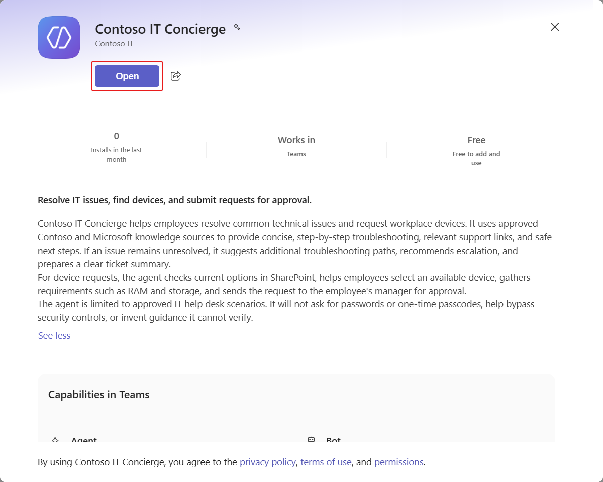

# 7 - Publish and plan for operation

**Estimated time:** 15 minutes

Publishing makes a saved version available through a channel. Sharing and tenant policies control who can discover and install it. Publishing does not change the agent's harness.

## Publish the agent and configure its listing

1. In **Build**, select **Publish**.
1. Select **Publish agent** in the confirmation dialog.
1. Wait for publication to finish.
1. Select **Add channels**.
1. Choose the Teams and Microsoft 365 channel.
1. Under **Availability**, select **Microsoft 365 Copilot and Microsoft Teams**.
1. Select **Add channel**.
1. Open **Teams + Microsoft 365** from **Channels**.

    

1. Select **About info**.
1. Set **Short description** to:

    ```text
    Resolve IT issues, find devices, and submit requests for review.
    ```

1. Set **Long description** to:

    ```text
    Contoso IT Concierge helps employees troubleshoot common IT issues using approved Microsoft and Contoso knowledge sources. It checks live device options in SharePoint, captures additional requirements, and sends a device request only after the employee confirms the request summary.

    This Microsoft Ignite 2026 PREL36 lab sends requests to the assigned lab mailbox for simulated manager review. It does not approve purchases or reserve stock. The agent does not ask for passwords or one-time passcodes, bypass security controls, or invent guidance it cannot verify.
    ```

1. Set **Developer name** to +++Contoso IT+++.
1. Select **Save**.
1. Publish the agent again to release the updated listing.

## Verify an employee channel

1. In **Teams + Microsoft 365**, select **Use and share**.
1. Select **View in Teams**.
1. Review the listing and confirm it identifies the agent and the lab's simulated request behavior.
1. Select **Add**.
1. Select **Open**.

    

1. Submit:

    ```text
    I get an access denied when trying to open this file in SharePoint.
    ```

1. Confirm the agent asks a focused question or provides safe troubleshooting, rather than suggesting bypassing permissions.
1. Submit +++I need a laptop+++ and inspect the response. Confirm the published agent retrieves live device options.
1. Cancel before submission. Do not send another email just to verify the channel.

> [!IMPORTANT]
> If installation is blocked by tenant policy, record that the channel test is blocked and ask the instructor. Do not change organization-wide app policies or claim that a successful Preview proves the published channel works.

If time remains, return to **Use and share**, select **View in Copilot**, and repeat a grounded troubleshooting prompt in Microsoft 365 Copilot. The timed path requires one working employee channel; a second-channel test is an extension, not a prerequisite for completing the four-hour build.

## Understand licensing and operation

The GitHub Copilot harness consumes **Copilot Credits** during LLM-powered authoring and runtime execution, including Preview and Evaluation. Manual configuration in **Build** and **Monitor** does not itself consume credits. A Microsoft 365 Copilot license does not replace credit capacity for this harness.

Model choice, runtime, context, and tool use affect consumption. Estimate with representative tasks, review real usage after publishing, and work with your platform administrator on capacity, permissions, and spend controls. Do not use this lab as a production pricing quote.

| Before a production rollout | Why it matters |
| --- | --- |
| Test representative requests and failures | Chat quality alone does not prove transaction correctness |
| Review permissions and data policies | Limit connectors to the intended resources and operations |
| Replace the lab recipient and define approvals | Sending a request email is not an approval process |
| Package and test solution dependencies | Connections, knowledge, tools, skills, and workflows must be verified in each environment |
| Monitor usage and publish changes deliberately | Updates and consumption need ongoing ownership |

For current terms, consult [GitHub Copilot harness billing](https://learn.microsoft.com/microsoft-copilot-studio/agents-experience/billing-credit-overview) and [Copilot Studio capacity management](https://learn.microsoft.com/power-platform/admin/manage-copilot-studio-messages-capacity).

## Lab complete

You built a solution-backed agent, grounded it in approved knowledge, connected live data and reusable skills, executed a confirmed request through a workflow, checked cancellation, and published to an employee channel.

Continue with [Agent Academy Recruit NextGen](https://microsoft.github.io/agent-academy/recruit-nextgen/) for the full conceptual lessons, additional skill iterations, and the course's separate badge requirements. PREL36 completion does not automatically grant the Academy badge.

In Skillable, select **Next**, then **Submit** when you are ready to finish the lab. On GitHub, return to the [lab overview](./README.md).
