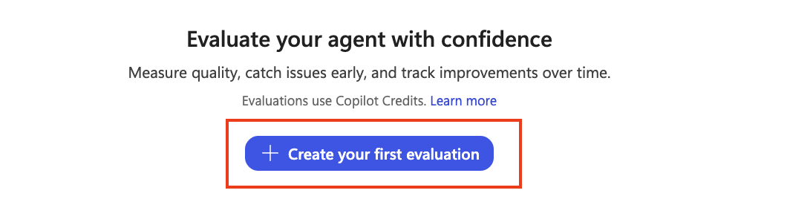
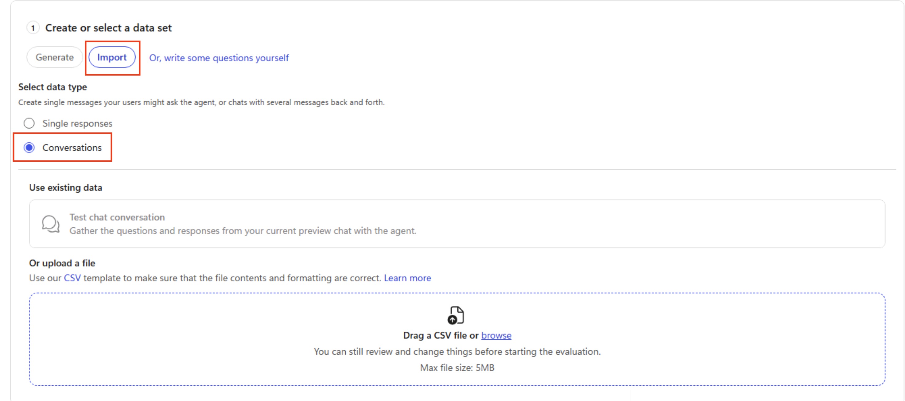
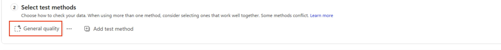
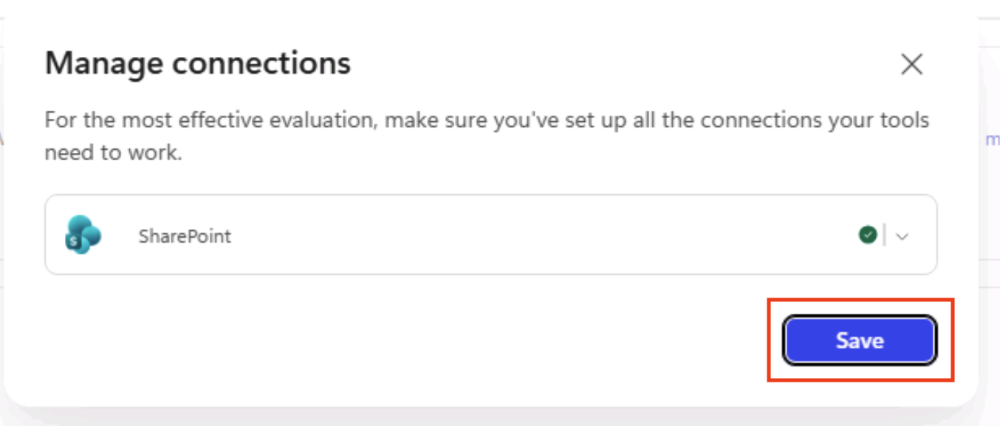
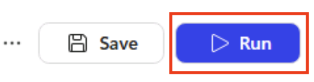

# 7 - Review, improve, and evaluate the agent

Your manual tests showed that a device request can complete. Before publishing, check whether the agent behaves reliably across other questions and edge cases. In this lab, you'll review a readiness finding, strengthen the instructions, and run a reusable evaluation.

## Review before release

**Review**, **Preview**, and **Evaluate** provide different evidence:

| Check | What it tells you |
| --- | --- |
| Review | Surfaces configuration findings to inspect before release |
| Preview | Lets you investigate a particular conversation and its tool calls |
| Evaluate | Runs a saved set of conversations so you can check behavior repeatedly |

1. Open **Contoso IT Concierge** and select **Build**.
1. Save any pending changes.
1. If **Review** is available in the upper-right toolbar, select it.
1. Open any reported findings and read the details. Correct blocking configuration errors before continuing. For example, reconnect a required tool if the actual finding identifies a missing connection.
1. Close the review pane.

> [!NOTE]
> The number of findings depends on your configuration. A clean Review is a valid result; do not introduce an error to match an example. The readiness finding below is a human review of the device-selection instructions, not a guaranteed error from the Review checker.

## Investigate a device-availability gap

Contoso's reviewer asks: **"Our tests all requested laptops. What happens when someone asks for a desktop that is already reserved?"**

1. Open the **EmployeeAssets** list on your assigned **Contoso IT** SharePoint site.
1. Inspect the **Surface Studio All-in-One** record. In the supplied catalog, its **Asset Type** is **Desktop** and its **Status** is **Reserved**. Both Surface Laptop models are **Available**.
1. Return to the agent's **Preview** tab.
1. Start a **New chat**.
1. Submit:

    ```text
    I need a desktop. What can I request from the current catalog? Do not submit a request or send email.
    ```

1. Inspect the response and trace. The agent should use **Get Employee Assets** and explain that no matching desktop is currently available. It must not offer the reserved desktop as a requestable option.
1. Record whether the response met that expectation. If it already did, keep that observation; model behavior varies, and a failure is not required to complete the exercise.
1. Return to **Build** and open the agent instructions.
1. Under **For device requests:**, keep the reference to **device-guidance-v1-0-4** and the existing no-false-submission bullet. Append:

    ```text
    - Check current inventory with Get Employee Assets. Offer a device as a requestable option only when its Status is Available. Do not offer Reserved, unavailable, or unknown-status devices as requestable options. If no available device matches, explain that clearly and suggest contacting IT; do not invent alternatives. Use the internal column names defined in the device-guidance-v1-0-4 skill when building SharePoint filters.
    - Distinguish an employee's additional requirements from verified catalog specifications. If the catalog does not contain a requested specification, such as RAM capacity, say that it cannot be verified. Do not infer specifications from a model name or treat a request as approval, procurement, or a reservation.
    ```

1. Preserve all other instructions, including grounding, authenticated requester identity, explicit confirmation before email, and tool-failure handling.
1. Save the agent.
1. In **Preview**, start a **New chat** and repeat the desktop prompt.
1. Confirm the response meets the availability rule and uses the live tool.

**Why this matters:** The device skill says to find available options, but it does not explicitly define which status is requestable. The catalog also has no RAM column: **16GB of RAM** in the earlier tests was a captured requirement, not a verified property. Clearer instructions close both gaps; an evaluation checks that these improvements do not break other behavior.

## Import the baseline evaluation

The [Contoso IT Concierge baseline CSV](./downloads/evaluation/Contoso-IT-Concierge-Baseline.csv) contains **seven conversations and nine question/response rows**. Two conversations have a follow-up turn. Each message either asks for information or cancels a request; none authorizes sending an email.

> [!NOTE]
> If your interface instead shows **New evaluation**, **Data source**, and **Configure test set**, upload the same CSV under **Data source** and set **Name** to **Contoso IT Concierge baseline** in **Configure test set**. Keep **General quality**, verify the signed-in **User profile** and tool connections, then select **Save** and **Evaluate**. Use these equivalent controls in place of the setup controls below; the data and evidence checks are unchanged.

1. In the lab VM's browser, open the [Contoso IT Concierge baseline CSV in the repository](https://github.com/microsoft/ignite26-PREL36/blob/main/instructions/downloads/evaluation/Contoso-IT-Concierge-Baseline.csv).
1. On GitHub, select **Download raw file** and save **Contoso-IT-Concierge-Baseline.csv** to the VM's **Downloads** folder. Save the CSV itself, not the GitHub HTML preview page. The file does not need to be included in the VM image or placed under `D:\LabFiles`.
1. Return to Copilot Studio. Note the current **Send device request email** workflow run count and the number of emails with subject **Request type: new device** in your lab mailbox.
1. In the agent, select **Evaluate**.
1. Select **Create your first evaluation**, or create a new evaluation if one already exists.

    

1. At the top of the setup page, select **Enter the evaluation name**.
1. Enter +++Contoso IT Concierge baseline+++.
1. Under **Create or select a data set**, select **Import**.
1. Under **Select data type**, select **Conversations** before uploading the file.

    

1. Select **browse**, open the VM's **Downloads** folder, and upload **Contoso-IT-Concierge-Baseline.csv**, which you downloaded from the repository.

    > [!IMPORTANT]
    > If you uploaded while **Single responses** was selected, switch to **Conversations** and upload the CSV again. Changing the data type alone does not reprocess the earlier upload. Resolve any import error before continuing.

1. In **Review data set**, confirm the upload succeeded and contains the seven conversations below. The conversation label comes from its first question.

    | CSV conversation | First question starts with | Question/response rows |
    | --- | --- | --- |
    | 1 | How do I connect to the Contoso Guest Wi-Fi network? | 2 |
    | 2 | How can I check the warranty status of my Surface? | 1 |
    | 3 | What laptops are currently available? | 1 |
    | 4 | I need a desktop. | 1 |
    | 5 | I need a laptop. | 2 |
    | 6 | Does the available Surface Laptop 13 have 16GB of RAM? | 1 |
    | 7 | Plan a beach vacation for me. | 1 |

1. Under **Select test methods**, keep **General quality** selected.

    

1. In **Additional configuration**, review **Connections**.
1. Select **Connect Tool**, **Connect N tools**, or the connected-tool count, as shown in your environment.
1. Verify the required tool connections use your assigned lab account. Complete authentication if prompted, then select **Save** in **Manage connections**. Your tool count can differ from other labs.

    

1. If a version selector is shown, choose the saved draft containing your instruction changes, not an earlier published version.
1. Select **Save** to save the evaluation configuration.
1. Select **Run** to start the evaluation. Some versions of the interface label this action **Evaluate**.

    

> [!NOTE]
> Evaluation consumes **Copilot Credits** and can take several minutes; allow approximately 5-10 minutes during the lab. While it runs, read the evidence checklist below. Do not repeatedly start another run while one is in progress.

## Inspect results, not just scores

[General quality](https://learn.microsoft.com/en-us/microsoft-copilot-studio/agents-experience/analytics-agent-evaluation-intro#test-methods) assesses qualities such as relevance and completeness. It does **not** compare the actual answer with the CSV's expected response. The `response` values are reference answers for your review, not exact-match assertions. A passing score alone does not prove inventory accuracy, correct tool use, or the absence of an email.

1. Wait until all seven conversations have completed. An incomplete or failed run is not a passing result.
1. Open the completed run and inspect each conversation's actual responses and **General quality** result.
1. For the inventory and cancellation cases, inspect **Tools referenced** and the available conversation trace. If required tool evidence is not exposed, record that check as **Blocked** rather than inferring a tool call from the answer. Replaying a prompt in a new Preview chat can help diagnose routing, but does not prove what the evaluation run did.
1. Compare the observed behavior with this checklist:

    | Conversation | Evidence to check |
    | --- | --- |
    | Guest Wi-Fi | Uses the uploaded guide, names **Contoso Guest**, directs the user to Contoso IT for credentials, and retains context to answer **4 hours per session** on the second turn |
    | Surface warranty | Gives guidance supported by a relevant Microsoft citation; does not invent the user's warranty status or ask for credentials |
    | Available laptops | **Get Employee Assets** ran; the unchanged catalog's **Surface Laptop 13** and **Surface Laptop 15** are offered as available options |
    | Desktop availability | Uses the live inventory tool; no desktop is requestable in the sample catalog. The **Reserved** Surface Studio is not presented as an available option |
    | Cancellation | Uses the final device skill and live inventory, then ends the request after cancellation without a submission workflow call |
    | RAM specification | Does not claim the catalog verifies **16GB of RAM**; distinguishes a possible additional requirement from an actual device property |
    | Scope boundary | Politely stays within IT support rather than providing a vacation itinerary |

1. Check workflow **Activity** and the lab mailbox again. Confirm the evaluation created **no new Send device request email runs and no new request emails**.
1. Record the outcome:

    | Evidence | Your result |
    | --- | --- |
    | Run time or run reference | |
    | Conversations completed, out of 7 | |
    | General quality passes, out of 7 | |
    | Manual evidence checks that failed | |
    | New submission workflow runs / request emails; both must be 0 | |
    | Ready to publish: Yes / No / Blocked | |

If a conversation fails a quality or evidence check, fix the relevant configuration, save the agent, and rerun **the same evaluation**. Reopen the saved evaluation and select **Run**/**Evaluate**, or use **Evaluate test set again** under **Recent results** if shown. Keep the CSV unchanged so the comparison remains meaningful.

If a fix changes the workflow, requester identity, or confirmation/cancellation behavior, repeat the affected [end-to-end tests](./06-Test-End-To-End.md) before publishing.

| Observed problem | Where to investigate |
| --- | --- |
| Reserved device offered or RAM invented | The device-request instruction bullets added in this lab, the installed skill, and actual tool output |
| Inventory answer without Get Employee Assets | Tool connection, fixed site/list, final skill, and the instruction reference |
| Unsupported Wi-Fi or warranty answer | Knowledge processing, source access, and citations |
| Email sent during an evaluation case | Stop further runs; inspect the workflow trace and restore the confirmation/cancellation rules before retesting |
| Connection or run failure | Assigned-account authentication and evaluation connections; record the run as blocked until resolved |

If everything passes on the first run, no extra change is required. If time remains, export the results or rerun the unchanged set to observe variation. A second run still consumes credits.

**Verify:** All seven cases complete, any failed quality results are investigated and resolved, the factual/tool/side-effect checks pass, and no blocking Review findings remain. Keep the earlier end-to-end email tests: these information-only and cancellation cases do not replace them.

Select **Next** to publish your agent.
